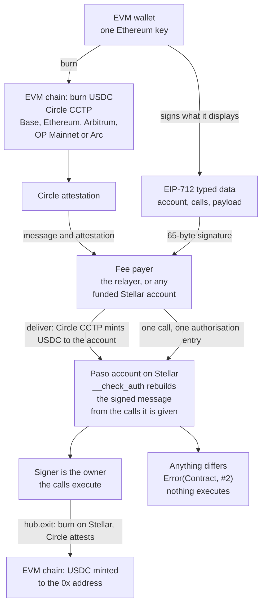

# Paso

[](https://github.com/RaYYeR220/paso/actions/workflows/ci.yml)

**Every Ethereum address already has a Stellar account.**

Live on mainnet and testnet: **https://paso-stellar.vercel.app**. On [mainnet](https://paso-stellar.vercel.app/app?network=mainnet) it works with your own wallet and real USDC. On testnet you can [try it without a wallet](https://paso-stellar.vercel.app/app?demo=1). The [proof page](https://paso-stellar.vercel.app/proof) links every claim to its transaction.

Watch the demo (2:49): https://youtu.be/St4Vwpt6Qhg

## What and why

The dollars are on EVM chains. A Stellar account asks for a new wallet, a new seed phrase, XLM for reserves and a trustline before the first dollar arrives, and MetaMask's native Stellar support still creates a classic account with those costs (1 XLM, plus 0.5 XLM per trustline). Paso derives a Soroban contract account from the 20-byte Ethereum address itself. That account accepts only an EIP-712 signature from that address, and it rebuilds the signed message on chain from the calls being authorised: what the wallet displays is exactly what executes, or nothing does. USDC arrives over Circle CCTP from Base, Ethereum, Arbitrum, OP Mainnet or Arc, and goes back the same way. A relayer pays the Stellar fees, so there is no new wallet, no seed phrase and no XLM.

Status: unaudited. There has been no third-party audit; the review in [docs/AUDIT.md](docs/AUDIT.md) is the project's own. The hub and the account code are deployed on Stellar mainnet and on testnet. The whole path has run on both: Base to the account, on to another account, and back to Base, with real USDC on mainnet. On mainnet it has run twice: once from the scripts, and once through the hosted app, driven by a scripted wallet. On testnet it has also run from Arc Testnet and back. Ethereum, Arbitrum and OP Mainnet are supported by the SDK, the scripts and the app, and their routes are checked on chain, but no transfer has run on them, and on mainnet only Base has. The hosted app serves both networks; on mainnet it takes your own wallet only. No browser wallet extension has been exercised live. [Limits](#limits) lists everything that is not done.

## See it

### Mainnet, through the hosted app

On 2026-10-13 the hosted app, switched to mainnet, ran the whole path with real USDC for the owner `0x20806157d9607050204bbbCd37CE71498B35D46c` and its account [`CBWU43ND…XEZ7EPX`](https://stellar.expert/explorer/public/contract/CBWU43NDIBPC6SD2WKVNJH6A5ROHGMSDJWAVLCO3RITO5Q264XEZ7EPX). It was driven by a scripted wallet: a Playwright test opens the site in a browser and puts a wallet at `window.ethereum` that speaks the standard wallet interface (EIP-1193) and signs with a key the test holds. No browser extension was involved. Times are block and ledger close times, UTC.

| Time | What happened | Transaction |
|---|---|---|
| 08:37:05 | USDC approval on Base, sent by the wallet | [`0xc51cb1bc…`](https://basescan.org/tx/0xc51cb1bc79348b5f23f368ef1030afd08cf07c926eec578335f37b9f83d79a52) |
| 08:37:07 | 0.5 USDC burned on Base for the account, sent by the wallet | [`0xd235da18…`](https://basescan.org/tx/0xd235da188139aa7ab9539f2090010e542c5966b2f720703fe2459e7550d5f6db) |
| 08:37:17 | Delivered on Stellar by the hosted relayer. The balance went from 0.39987 to 0.899805 USDC | [`d2cf5d62…`](https://stellar.expert/explorer/public/tx/d2cf5d6274c026fdfc01f36284f11e576d76d0ccd0c0f213c06bfffa351d2f0f) |
| 08:37:27 | 0.1 USDC sent to `CDHTLX2766XMPFB5JT5T6UR3QIIAMP5PKMQHUS3PL5AAD6OUYVDG7JQT`, the account of `0x5BED629d44E4D76de7707b9Fd9d0Fe95B160B152`. Signed in the wallet, relayed | [`622c2279…`](https://stellar.expert/explorer/public/tx/622c2279221b2a4a6bce929cc0bdda595a07600e5dc0cf357888770f879e35cc) |
| 08:37:37 | 0.2 USDC sent back to Base: `hub.exit` and its nested `transfer`, one signature, relayed | [`517fab23…`](https://stellar.expert/explorer/public/tx/517fab234609285ebb0f8afe9b138724b790b61f94207a663df2f127ba4a7e38) |
| 08:37:53 | Minted on Base to the owner. The wallet submitted the mint and paid its gas | [`0x60865a32…`](https://basescan.org/tx/0x60865a32075866fa48437e9643976a59e6370f409b2f6bf3c04bcc0cf9d3be31) |

48 seconds from the approval on Base to the mint on Base. The three Stellar transactions were paid by the hosted relayer's mainnet account, `GAS65I36DQSMBSEZRN5KXDJMRCNEWNEX2VANOQB2QZQX5JX2X6D4SQBM`: 0.0280702, 0.0398373 and 0.0044255 XLM. `pnpm verify 622c2279221b2a4a6bce929cc0bdda595a07600e5dc0cf357888770f879e35cc --network mainnet` exits 0.

On mainnet the hosted app is wallet-only: there is no demo key and no faucet. Its relayer pays at most 0.3 XLM of resource fees for one transaction and 2 XLM of fees in a day, and pays nothing once its account holds less than 2 XLM. The app brings over at most 25 USDC in one transfer. The wallet submits its own mint on Base when USDC goes back. Deployment is not offered on its own: the deploy route answers 404 on mainnet, and the relayer deploys an account only when it relays that account's first signed call, after checking the signature off chain. The command for the scripted-wallet run is under [Scripts](#scripts).

### Mainnet, from the scripts

One run on 2026-10-12 with 1 USDC, for the same owner, made by `scripts/e2e.ts` without the web app and without its relayer: burn on Base [`0x460008a2…`](https://basescan.org/tx/0x460008a250884ff32698bd849f2094f2217c8b613a3ce3c5041a44730194994c), delivery [`a742bf77…`](https://stellar.expert/explorer/public/tx/a742bf77748cc1d2fb25347996dea79fa4e3827d7005cf6391588874a44fe1a0) into the account before it was deployed, deployment [`8da9a459…`](https://stellar.expert/explorer/public/tx/8da9a45941d661070efbbf0c0276f7d483488ce2e5003e478dc1f0feef57b6ea), 0.1 USDC to the never-deployed account of another Ethereum address [`85cb7efa…`](https://stellar.expert/explorer/public/tx/85cb7efa882a1cc6cc54c294bd7d60e5c7b6e47c8221ff7625fb44f6623e2322), exit [`fccc2318…`](https://stellar.expert/explorer/public/tx/fccc2318b8322cc020fd0d6c0a84f05dea45a36725ae9ba24f36a6a7287d76c6), mint on Base [`0x5b713522…`](https://basescan.org/tx/0x5b713522befbbeeb702d9bb8d48e4fc13da7585b3222ec52e5e7296caf3e4776), and an `approve` for amount `1` [`9f7172de…`](https://stellar.expert/explorer/public/tx/9f7172de421fe48032130cf76432432a4a1a3298e0003ff3763e759d3b0ba8a2). It ran in two parts, 17:42 to 17:44 and 18:00 to 18:01 UTC.

The last transaction, [`eb945398…`](https://stellar.expert/explorer/public/tx/eb94539839cba10012c01cea9453410d740d89194c2e99c4b33958aec144b6a3), carried the owner's signature for amount `1` with the amount changed to `10000000000000`. The account contract rebuilt the message from the call it was given, recovered a signer that is not the owner, and returned `Error(Contract, #2)` (`BadSignature`). Nothing executed. Every Stellar fee was paid by a separate account; the owner's account paid none. [docs/VERIFY.md](docs/VERIFY.md#6-the-same-on-mainnet) has the times and the checks.

### Testnet

The same path on Base Sepolia and Stellar testnet, 32 seconds from the burn to the mint back on Base: burn [`0x43c00d27…`](https://sepolia.basescan.org/tx/0x43c00d27bf35c2288c160e6e1bfad424a206dc0e0b2d0ae901e7b20a88879b9e), delivery [`f7c95418…`](https://stellar.expert/explorer/testnet/tx/f7c95418993326f42b05c8a682e9dc3a9a7e18d0ad267b168eba09b1a40d23f1), transfer [`dc3db1dd…`](https://stellar.expert/explorer/testnet/tx/dc3db1dd76496889c53a0007d3017e6b0d8019848c4ebbe555f9899b76eadf63), exit [`6cae28f1…`](https://stellar.expert/explorer/testnet/tx/6cae28f1ea0f3d8020cfda61f75cfb6b8b13914fe859569d20c9e935a2e79a2f), mint [`0xd81b8b7e…`](https://sepolia.basescan.org/tx/0xd81b8b7e8f762910712494e3fba1b29144f2cef41a27081c44adb820ee5b137d), accepted [`b8a81489…`](https://stellar.expert/explorer/testnet/tx/b8a81489a2b20babc3ceadf6c9b22ba15965c725a6594b3413de6c4aadc91ac5), refused [`ded23530…`](https://stellar.expert/explorer/testnet/tx/ded23530dfc8d114a1350522e45b257170ed775738b0e85887f0e6667d52b181). [docs/VERIFY.md](docs/VERIFY.md) walks through it.

### Arc Testnet

The same path with Arc Testnet as the EVM side, on 2026-10-13. On Arc gas is paid in USDC, and there is no fast transfer. The standard transfers from Arc were delivered 10 and 7 seconds after their burns, and Circle kept nothing. From the scripts, 28 seconds from the burn to the mint back on Arc: burn [`0x3bfe9927…`](https://explorer.testnet.arc.io/tx/0x3bfe9927a2c72308e02ec9d63bc1a7dbe18daac501748946df09ca9d6ddf668d), delivery [`040af2cb…`](https://stellar.expert/explorer/testnet/tx/040af2cbc1d2fbee714c1f2bbd32f785a07e15b947d189d0b91a875c22db4e89), exit [`a55ce5aa…`](https://stellar.expert/explorer/testnet/tx/a55ce5aacf46fab6c04c7dc8150474fac6aa3c0be8d153ab97b271abf9e9d2ee), mint [`0xfafb8dde…`](https://explorer.testnet.arc.io/tx/0xfafb8ddec2bb4094c296a1e658014ffe4a6dea44a320633bc394eb9c861ab2a9), refused [`f3eca454…`](https://stellar.expert/explorer/testnet/tx/f3eca45441f58d2ba689ea72474465b36e5fb7c234795ca20fc589f3ccbb8917). Through the app, with the scripted wallet submitting the mint on Arc itself: burn [`0x87466509…`](https://explorer.testnet.arc.io/tx/0x87466509c2c5497d00cd1153e2533ff43ff1d7880061b61f591c051b74207dcf), delivery [`9a9d4aa3…`](https://stellar.expert/explorer/testnet/tx/9a9d4aa3e4d412082f1289546bbc0062e45c06c5fbce2a1b1a8cff51fb7996ec), exit [`80d3f6d7…`](https://stellar.expert/explorer/testnet/tx/80d3f6d7a756ed3207c081853f1d673de060d4d3c722b17b108873fd2458dff3), mint [`0xcd1abc65…`](https://explorer.testnet.arc.io/tx/0xcd1abc65e901b4e93399c3286c9d43a330ff6cd0f12bcbcc9aa06f0c208b0241). [docs/VERIFY.md](docs/VERIFY.md#8-the-five-evm-chains-and-the-runs-from-arc) has every step of both runs.

## Supported chains

| EVM chain | Its testnet | CCTP domain | Gas | Run live |
|---|---|---|---|---|
| Base | Base Sepolia | 6 | ETH | Mainnet and testnet, both ways |
| Ethereum | Ethereum Sepolia | 0 | ETH | No |
| Arbitrum | Arbitrum Sepolia | 3 | ETH | No |
| OP Mainnet | OP Sepolia | 2 | ETH | No |
| Arc | Arc Testnet | 26 | USDC | Testnet, both ways |

Each chain is supported both ways: USDC comes into an account from it and goes back out to it. Stellar is CCTP domain 27. `pnpm routes --network <testnet|mainnet>` reads every Circle contract address and Stellar's registration of each chain back from the chains, with no key, and exits 0 when all of them check out; on 2026-10-13 it did on both networks. A route that checks out has not carried a transfer by that fact: "No" means no transfer has run on that chain, on either network. On testnet, `pnpm e2e --chain <name> --dry-run` simulates a run on one of them and sends nothing.

In the app a wallet chooses the chain to bring USDC from and the chain to send it back to. The demo key uses Base Sepolia only. The hosted relayer accepts a burn from any of the five for delivery and refuses other domains. It pays for the mint on the way back only on Base Sepolia; on mainnet, and on every other chain, the wallet submits the mint. On 2026-10-13 Circle charged 1 to 1.4 basis points for a fast transfer towards Stellar and nothing for a standard one or for the way back.

## How it works



Solid arrows: executed live with Base on Stellar mainnet and testnet, and with Arc Testnet on Stellar testnet; transactions are linked under [See it](#see-it) and [Proof](#proof). With Ethereum, Arbitrum and OP Mainnet, and with Arc on mainnet, the same arrows are built and not run live ([Supported chains](#supported-chains)).

1. **Derive.** The hub contract deploys accounts with the salt `12 zero bytes ‖ 20-byte Ethereum address`. The account address is the id of that contract, so it depends only on the network, the hub and the Ethereum address. `hub.address_of(owner)` returns it on chain; `twinAddress(owner, network)` in the SDK computes it with no network call. The address can receive USDC before anything is deployed. `hub.deploy(owner)` is open to anyone and repeating it changes nothing.
2. **Fund.** USDC is burned on one of five EVM chains through Circle's CCTP contracts. Circle attests the burn. Anyone can deliver the attested message on Stellar: `deliverWith` in the SDK and `pnpm deliver` do it from any funded account, and the relayer has a route for it. Circle's contracts decide where the USDC goes.
3. **Act.** The SDK simulates a call and gets the one authorisation entry the account must sign. It renders the entry as EIP-712 typed data. The wallet signs. A fee payer wraps the call and the signed entry in its own transaction. The Soroban host calls the account's `__check_auth`, which renders every call to text, hashes it as EIP-712, recovers the signer and compares it with the stored owner.
4. **Leave.** `hub.exit` sends USDC from the account over CCTP to the EVM chain and address named in the signed call. One signature covers `exit` and the USDC `transfer` nested inside it. Once Circle has attested the exit, anyone can submit the mint on that chain: the owner's wallet in the app, the hosted relayer on Base Sepolia, or `pnpm mint` from any account there with gas.

The fee payer is the relayer (`POST /api/relay`) or any funded Stellar account (`submitWith` in the SDK). It pays and nothing else: it cannot change the call, and `pnpm e2e` runs without a relayer.

## What you sign

This is the message behind the [first call of the testnet example account](https://stellar.expert/explorer/testnet/tx/43a92797a315f742ef121ec607e9d2ca23b68e10eb6d2ce931f5e7f7f0ad6d90). `types` is left out here; it is in [docs/ENCODING.md](docs/ENCODING.md).

```json
{
  "domain": {
    "name": "Paso",
    "version": "1",
    "salt": "0xcee0302d59844d32bdca915c8203dd44b33fbb7edc19051ea37abedf28ecd472"
  },
  "primaryType": "Authorization",
  "message": {
    "account": "CCI3UVOB35NEJCTKPCLSPJVT745BNT2QNACV3QP46CRYTVD3QCOH2VME",
    "calls": [
      {
        "contract": "CBIELTK6YBZJU5UP2WWQEUCYKLPU6AUNZ2BQ4WWFEIE3USCIHMXQDAMA",
        "fn": "approve",
        "args": [
          "CCI3UVOB35NEJCTKPCLSPJVT745BNT2QNACV3QP46CRYTVD3QCOH2VME",
          "CBNSNERNVI7NW7JWDLOFJQJYMJC67EMVZLQONBBPWR4HLQMP53QGFOBO",
          "1",
          "5159846"
        ]
      }
    ],
    "payload": "0x57246257bd3aa74bb65b3bfdfdfd7d2093286f6d309e8df1f60d3d11b0f1f3e7"
  }
}
```

| Field | Meaning in this message |
|---|---|
| `domain.salt` | The Stellar network id: sha256 of the testnet passphrase. A signature for testnet is not valid on mainnet. |
| `account` | The account that checks the signature. A signature for one account is not valid for another. |
| `contract` | The contract being called: USDC on testnet. |
| `fn` | The function: `approve`. |
| `args` | From the account, to the hub, amount `1` (0.0000001 USDC), allowance valid until ledger `5159846`. |
| `payload` | The Soroban authorisation payload. It binds the network, a nonce, the last ledger at which the signature is accepted, and the full call tree. |

The EIP-712 digest of this message is `0xfc4623691cc7ce8a8104ed462f05dd5ad26af83865f63f7d2ed69710402f130f`. The signature in the transaction recovers to `0x7880DA9a52Af491f76421869d4e28DC0A4D1767C`, the owner stored in the account. `pnpm verify` reproduces both from public chain data.

A call that makes further calls on the account's behalf lists all of them. The testnet exit was signed as two calls:

```
calls[0]  hub   exit      account, 5000000, 6, 0x0000000000000000000000007880da9a52af491f76421869d4e28dc0a4d1767c, 0, 1000
calls[1]  USDC  transfer  account, hub, 5000000
```

Here `account`, `hub` and `USDC` stand for the three `C…` addresses, which the message spells out in full. The arguments of `exit` are the amount (0.5 USDC), the CCTP domain of Base, the recipient on Base padded to 32 bytes, the fee cap and the finality threshold.

The account contract never sees the JSON. It receives the calls from the host and builds the same text itself. If the text it builds differs in one character from what the wallet showed, the digest differs, the recovered address is not the owner, and the transaction fails.

## Proof

2026-10-12 and 2026-10-13. The runs are linked under [See it](#see-it); [docs/VERIFY.md](docs/VERIFY.md) lists every transaction of each with its time.

**The code on chain is this code, checked on every push.** The [CI workflow](.github/workflows/ci.yml) builds both contracts on Linux with Rust 1.99.0 and Stellar CLI 28.1.0, and fails unless their sha256 hashes equal the deployed code listed in [`.github/deployed-wasm.sha256`](.github/deployed-wasm.sha256). It also reads the code hashes from mainnet and testnet and fails if a network answers with another one. Locally, with the same two versions:

```sh
stellar contract build
shasum -a 256 target/wasm32v1-none/release/paso_account.wasm target/wasm32v1-none/release/paso_hub.wasm
# 2ee1ac08ca6407667db15bcffe75c8cbb4e41d95b2d047541b5dad133cfe75ee  target/wasm32v1-none/release/paso_account.wasm
# aeaa1c72f607071fd1f383638fa0c850df1c15bd051b3e1061ac57bc0e46b045  target/wasm32v1-none/release/paso_hub.wasm
```

The contracts are not shown as verified on stellar.expert. That needs a `source_repo` entry inside the deployed code, which these builds do not have, and adding one changes the hash, so it means deploying again. The [release workflow](.github/workflows/release.yml) makes attested builds for future deployments; it has not been run.

**Mainnet: Stellar public network and Base**

- Hub contract: [`CDZCHMNS…AB7LJK`](https://stellar.expert/explorer/public/contract/CDZCHMNSAAIST5K2DNP4DP6H3DE4UJISUOMDFQTKD7IK6CD477AB7LJK), deployed in [`9285fcdb…`](https://stellar.expert/explorer/public/tx/9285fcdb5d3f065c196816810ff6af1ff453ece88824e5775bd4602154082426).
- Account code: wasm hash `2ee1ac08ca6407667db15bcffe75c8cbb4e41d95b2d047541b5dad133cfe75ee`, the same as on testnet, uploaded in [`eb90e5f9…`](https://stellar.expert/explorer/public/tx/eb90e5f911d097cbbaf724bed6ab670a7a2cf3843c4a1ffb89397ce34ce05135). Hub code uploaded in [`c3eca151…`](https://stellar.expert/explorer/public/tx/c3eca151541a5e66d2d7679a37492686cd5dd46a1c5f7c66c1f9f8bcb6139161).
- Account of `0x20806157d9607050204bbbCd37CE71498B35D46c`: [`CBWU43ND…XEZ7EPX`](https://stellar.expert/explorer/public/contract/CBWU43NDIBPC6SD2WKVNJH6A5ROHGMSDJWAVLCO3RITO5Q264XEZ7EPX). It received USDC in [`a742bf77…`](https://stellar.expert/explorer/public/tx/a742bf77748cc1d2fb25347996dea79fa4e3827d7005cf6391588874a44fe1a0) and was deployed later, in [`8da9a459…`](https://stellar.expert/explorer/public/tx/8da9a45941d661070efbbf0c0276f7d483488ce2e5003e478dc1f0feef57b6ea).
- Paid before it had an account, twice: the owner's own account above, and 0.1 USDC to `CCSLYO2GFX5G7STNB37YZ44KB7WLBB72UH5Z7CD3UUZ64RAU6AHT4LNX`, the never-deployed account of `0xEe67130Fa530c04b88D6Fd99fcc7D1D1494841f8`, in [`85cb7efa…`](https://stellar.expert/explorer/public/tx/85cb7efa882a1cc6cc54c294bd7d60e5c7b6e47c8221ff7625fb44f6623e2322).
- On Base: USDC approval [`0x53eb5943…`](https://basescan.org/tx/0x53eb5943435834ca70659f5bf3715e5c7d7f82c10516955083260a316920f469), burn [`0x460008a2…`](https://basescan.org/tx/0x460008a250884ff32698bd849f2094f2217c8b613a3ce3c5041a44730194994c), mint [`0x5b713522…`](https://basescan.org/tx/0x5b713522befbbeeb702d9bb8d48e4fc13da7585b3222ec52e5e7296caf3e4776).
- Refused on mainnet, amount changed after signing, submitted on purpose: [`eb945398…`](https://stellar.expert/explorer/public/tx/eb94539839cba10012c01cea9453410d740d89194c2e99c4b33958aec144b6a3), FAILED, result `txFailed, invokeHostFunctionTrapped`. Host log: `["failed account authentication with error", CBWU43ND…XEZ7EPX, Error(Contract, #2)]`. Error 2 is `BadSignature`.
- Through the hosted app: the six transactions in the [first table](#mainnet-through-the-hosted-app). `POST /api/cctp/deliver` and `POST /api/relay` ran on mainnet; the mint on Base was submitted by the wallet.
- Scope: the contracts, one scripted run and one run through the hosted app with a scripted wallet, both with Base. No other EVM chain has carried a transfer on mainnet. No browser wallet extension has been used.

**Testnet: deployment**

- Hub contract: [`CBNSNERN…QGFOBO`](https://stellar.expert/explorer/testnet/contract/CBNSNERNVI7NW7JWDLOFJQJYMJC67EMVZLQONBBPWR4HLQMP53QGFOBO), deployed in [`fdacf6ee…`](https://stellar.expert/explorer/testnet/tx/fdacf6ee2c1b428ab4d5773070ec2270036d3939865c6b01b902e83ad7d44b45). Hub code, 4,156 bytes, uploaded in [`cb039f10…`](https://stellar.expert/explorer/testnet/tx/cb039f10a642650601f91101d1ee1d388edad529071b2b61ac8dc351bc83f652).
- Account code, 7,837 bytes, uploaded in [`2d6baec6…`](https://stellar.expert/explorer/testnet/tx/2d6baec6ecf690266226141fe1a0bf747f58978be3537180416722180dfec96d).
- Example account: owner `0x7880DA9a52Af491f76421869d4e28DC0A4D1767C` has the account [`CCI3UVOB…OH2VME`](https://stellar.expert/explorer/testnet/contract/CCI3UVOB35NEJCTKPCLSPJVT745BNT2QNACV3QP46CRYTVD3QCOH2VME), deployed in [`e5fe8370…`](https://stellar.expert/explorer/testnet/tx/e5fe8370b67f0ba7d9e1f24f108824e3ecacad72663e73ffb03e79798a4050b4). A second `deploy` for the same owner changed nothing: [`b1e88787…`](https://stellar.expert/explorer/testnet/tx/b1e8878740ee55801bcdaddd5b8985acb29024212f1ac8f0134ad2735ec455b3).

**Testnet: signing**

- The example account's first call, a USDC `approve` authorised by an Ethereum signature: [`43a92797…`](https://stellar.expert/explorer/testnet/tx/43a92797a315f742ef121ec607e9d2ca23b68e10eb6d2ce931f5e7f7f0ad6d90), SUCCESS, ledger 5159648.
- Refused on chain: [`ded23530…`](https://stellar.expert/explorer/testnet/tx/ded23530dfc8d114a1350522e45b257170ed775738b0e85887f0e6667d52b181), FAILED, ledger 5160302, host log `["failed account authentication with error", CCI3UVOB…OH2VME, Error(Contract, #2)]`. Two earlier ones: [`32a1c98d…`](https://stellar.expert/explorer/testnet/tx/32a1c98dd9f14ffcae41448cdacd525f5f76b073aa695cc9a3c018bd56ade1b3) and [`e8a91143…`](https://stellar.expert/explorer/testnet/tx/e8a91143725b27bdd36fd997b6262d3196048e0edf4793e9bbf5c388bc0e9d7a).
- Paid before it had an account: 0.1 USDC to `CAT44DMN6RQ44HZDEBJUSBWRJ3YOICUNPFHYIG6FSEUWFEBUYWIVY7FJ`, the never-deployed account of `0xC801b29BC8eE267cA2C353fF146FFa642Cc2BE85`, in [`dc3db1dd…`](https://stellar.expert/explorer/testnet/tx/dc3db1dd76496889c53a0007d3017e6b0d8019848c4ebbe555f9899b76eadf63).

**Testnet: through the web app and the relayer**

These transactions were signed in the browser with the app's demo key, or by the scripted wallet. No wallet extension was used.

- `POST /api/relay`: from the end-to-end script, an account deployed in [`0ec43de4…`](https://stellar.expert/explorer/testnet/tx/0ec43de437e650f7db5aa8bf942bf2f7460a168020f17ddfceae7c9f51febda9) and its call relayed in [`5a6cf2ec…`](https://stellar.expert/explorer/testnet/tx/5a6cf2ece6050bcd5d96d59b71162f1de514119ae8acbc99adbcbc37158bb890). From the app, a 0.1 USDC send relayed in [`ee5ca8c9…`](https://stellar.expert/explorer/testnet/tx/ee5ca8c9244c23c942ff2f2a8a280130bae2c58b66a67e272c40857909f70a0d).
- `POST /api/demo/fund` and `POST /api/cctp/deliver`: faucet burn on Base Sepolia [`0xb3474363…`](https://sepolia.basescan.org/tx/0xb3474363c81c3f1458423a1003f38c24deba51a17b5700cb71b386262b5854dd), delivered by the relayer in [`0e906ad1…`](https://stellar.expert/explorer/testnet/tx/0e906ad1652c2f5c2635d0082085d7b13bbfe309856944bf7a062239987d6669).
- `POST /api/cctp/complete`: exit from the app [`f568145f…`](https://stellar.expert/explorer/testnet/tx/f568145fef34bceac94cfd5286c8a461c3315462f548fb451606434d122a035a), minted on Base Sepolia by the relayer in [`0x126161a9…`](https://sepolia.basescan.org/tx/0x126161a91176872959d8141ee6d449c93f0f0ae33d82dfc3d62377acf7467f94).
- A send changed after signing was refused by the relayer's simulation with `bad_signature` (HTTP 422). Nothing was sent, so there is no transaction to link.
- The scripted wallet on testnet, 2026-10-13: approval [`0xb81b129d…`](https://sepolia.basescan.org/tx/0xb81b129dbda737f45aa416e82b4edacaddbeaf392ddec01e39ed3a8b12d2ee98), burn [`0x9b9718aa…`](https://sepolia.basescan.org/tx/0x9b9718aab40bac451ccf0adaf9c7cc15f6cd2625399322690ff8136c000cfb7b), delivery [`f6a76878…`](https://stellar.expert/explorer/testnet/tx/f6a7687847e19e6ac812cf10d0f0522361dcf4ecc1ab56ebade166ad18c87cb8), transfer [`e7861ada…`](https://stellar.expert/explorer/testnet/tx/e7861ada2da8a3e3d336bd4707c6a09dd99124f4a69dfbc41d1f5385d3ce8a45), exit [`6d223692…`](https://stellar.expert/explorer/testnet/tx/6d223692392bef017fb3bab59771f252f6f5be7c8eb49d79671f732ef7525720), mint paid by the relayer [`0x4985af35…`](https://sepolia.basescan.org/tx/0x4985af3543657d886403fcb65b37a400a2a816af3eb843fc72a77625de6cf11d). With the wallet submitting the mint itself: exit [`77e63f5f…`](https://stellar.expert/explorer/testnet/tx/77e63f5f07c819b5c9f2cae3c4d43f32e7c669fbc086d237d6938a2f693c0b0b), mint [`0xc005d89c…`](https://sepolia.basescan.org/tx/0xc005d89c638905d3d030c42ec20539bb59fba82421d8aa76b3f93672c832e8a9).
- The scripted wallet with Arc Testnet, 2026-10-13: the relayer delivered the burn from Arc and relayed the calls; the wallet submitted the mint on Arc. The transactions are under [Arc Testnet](#arc-testnet).

**Fees charged on mainnet**

| Transaction | XLM |
|---|---|
| Upload the account code ([`eb90e5f9…`](https://stellar.expert/explorer/public/tx/eb90e5f911d097cbbaf724bed6ab670a7a2cf3843c4a1ffb89397ce34ce05135)) | 9.3681676 |
| Upload the hub code ([`c3eca151…`](https://stellar.expert/explorer/public/tx/c3eca151541a5e66d2d7679a37492686cd5dd46a1c5f7c66c1f9f8bcb6139161)) | 5.9556408 |
| Deploy the hub ([`9285fcdb…`](https://stellar.expert/explorer/public/tx/9285fcdb5d3f065c196816810ff6af1ff453ece88824e5775bd4602154082426)) | 0.0530724 |
| Deliver a CCTP message ([`a742bf77…`](https://stellar.expert/explorer/public/tx/a742bf77748cc1d2fb25347996dea79fa4e3827d7005cf6391588874a44fe1a0)) | 0.0658391 |
| Deploy an account ([`8da9a459…`](https://stellar.expert/explorer/public/tx/8da9a45941d661070efbbf0c0276f7d483488ce2e5003e478dc1f0feef57b6ea)) | 0.0262901 |
| USDC transfer to an address with no balance yet ([`85cb7efa…`](https://stellar.expert/explorer/public/tx/85cb7efa882a1cc6cc54c294bd7d60e5c7b6e47c8221ff7625fb44f6623e2322)) | 0.0398373 |
| Exit to Base ([`fccc2318…`](https://stellar.expert/explorer/public/tx/fccc2318b8322cc020fd0d6c0a84f05dea45a36725ae9ba24f36a6a7287d76c6)) | 0.0426572 |
| `approve` ([`9f7172de…`](https://stellar.expert/explorer/public/tx/9f7172de421fe48032130cf76432432a4a1a3298e0003ff3763e759d3b0ba8a2)) | 0.0022547 |
| The refused transaction ([`eb945398…`](https://stellar.expert/explorer/public/tx/eb94539839cba10012c01cea9453410d740d89194c2e99c4b33958aec144b6a3)) | 0.0014289 |
| Deliver a CCTP message, hosted relayer ([`d2cf5d62…`](https://stellar.expert/explorer/public/tx/d2cf5d6274c026fdfc01f36284f11e576d76d0ccd0c0f213c06bfffa351d2f0f)) | 0.0280702 |
| USDC transfer, hosted relayer ([`622c2279…`](https://stellar.expert/explorer/public/tx/622c2279221b2a4a6bce929cc0bdda595a07600e5dc0cf357888770f879e35cc)) | 0.0398373 |
| Exit to Base, hosted relayer ([`517fab23…`](https://stellar.expert/explorer/public/tx/517fab234609285ebb0f8afe9b138724b790b61f94207a663df2f127ba4a7e38)) | 0.0044255 |

All of it was paid by `GAS65I36DQSMBSEZRN5KXDJMRCNEWNEX2VANOQB2QZQX5JX2X6D4SQBM`. The uploads and the hub deployment are paid once per network. On Base the owner paid the gas of the burn and of the mint.

The hosted relayer's limits are settings. By default it refuses a transaction whose resource fee is above 0.5 XLM on testnet and 0.3 XLM on mainnet, and stops at 50 XLM of fees in 24 hours on testnet and 2 XLM on mainnet. On mainnet it also stops paying once its account holds less than 2 XLM.

**Tests**

- 50 for the account contract and 28 for the hub: `pnpm test:contracts`. 21 and 13 of them are the tests of the project's own security review, [docs/AUDIT.md](docs/AUDIT.md). They demonstrate each limit it found and each attack that was refused, so a pass there does not mean "safe".
- 812 for the SDK offline: `PASO_OFFLINE=1 pnpm test:sdk`. 10 more read testnet or need a key.
- 552 for the web app and the relayer offline: `PASO_OFFLINE=1 pnpm test:web`. 25 more need testnet, keys or a running server.
- Every CCTP route, read from the chains: `pnpm routes --network testnet` and `pnpm routes --network mainnet`. See [Supported chains](#supported-chains).
- The scripted-wallet journey through the app, on a network you choose: `pnpm --filter @paso/web e2e`. It moves funds; see [Scripts](#scripts).
- 45 Rust tests and 14 JavaScript tests for the OpenZeppelin verifier, in [`verifiers`](verifiers/README.md).
- 14 signing vectors in [`fixtures/vectors.json`](fixtures/vectors.json). The Rust suite and the TypeScript suite both check the rendered text, the digest and the recovered signer of every vector.
- The order in which the host lists calls to `__check_auth` (root first, then sub-calls depth first) is checked by a contract test that goes through the real host path: `host_lists_contexts_root_first_then_depth_first`.

[docs/CLAIMS.md](docs/CLAIMS.md) lists every claim with its evidence, and what is not claimed.

## Verify it yourself

After `pnpm install`:

```sh
# 1. Rebuild the signed message from the mainnet transfer, recover the signer, compare with the account's owner. Exits 0.
pnpm verify 85cb7efa882a1cc6cc54c294bd7d60e5c7b6e47c8221ff7625fb44f6623e2322 --network mainnet

# 2. The same check on the transaction refused on mainnet. The recovered signer is not the owner. Exits 1.
pnpm verify eb94539839cba10012c01cea9453410d740d89194c2e99c4b33958aec144b6a3 --network mainnet

# 3. Build both contracts and run their tests: 50 + 28.
pnpm test:contracts

# 4. Read Circle's contracts for all five EVM chains and Stellar's registration of each, with no key. Exits 0.
pnpm routes --network mainnet
```

Commands 1, 2 and 4 need Node.js and pnpm only. Command 3 needs Rust and the Stellar CLI.

Without `--network mainnet` the same command checks testnet: `pnpm verify 43a92797a315f742ef121ec607e9d2ca23b68e10eb6d2ce931f5e7f7f0ad6d90` exits 0 and `pnpm verify ded23530dfc8d114a1350522e45b257170ed775738b0e85887f0e6667d52b181` exits 1.

`pnpm verify` reads a public Soroban RPC, which keeps about a week of transactions. After that, `pnpm e2e --stellar-only` makes a fresh accepted call and a fresh refusal on testnet with a new key.

[docs/VERIFY.md](docs/VERIFY.md) walks through every check.

## Run it

### Prerequisites

| Tool | Version |
|---|---|
| Node.js | 22.12 or newer |
| pnpm | 12.11.2 |
| Rust | stable, with the `wasm32v1-none` target (`rust-toolchain.toml` selects both; built with 1.99.0) |
| Stellar CLI | 28.1.0 was used for `stellar contract build` and the deployment |

The contracts use `soroban-sdk` 29.0.0.

### Install, build, test

```sh
git clone https://github.com/RaYYeR220/paso
cd paso
pnpm install

pnpm build:contracts   # target/wasm32v1-none/release/paso_account.wasm and paso_hub.wasm
pnpm test:contracts    # 50 account tests, 28 hub tests

pnpm build:sdk
PASO_OFFLINE=1 pnpm test:sdk   # 812 tests
PASO_OFFLINE=1 pnpm test:web   # 552 tests: the relayer and the web app's logic
```

`PASO_OFFLINE=1` skips every test that reaches a network. Without it, `pnpm test:sdk` runs 10 more: 8 read Stellar testnet and 2 need `PASO_E2E_OWNER_KEY`. `pnpm test:web` has 25 more: they send testnet transactions and need `RELAYER_SECRET` and `PASO_E2E_OWNER_KEY`, or drive a running server named in `PASO_SMOKE_URL`.

### Environment

Copy `apps/web/.env.example` to `apps/web/.env.local`. The dev server and the web tests read that file; so do the scripts on testnet. On mainnet the scripts read the environment alone.

For testnet one variable is enough: `RELAYER_SECRET`, the secret key of a funded Stellar testnet account that pays the fees. The same server also serves mainnet when `PASO_ALLOW_MAINNET=true` and `RELAYER_SECRET_MAINNET`, an account of its own, are set. Every variable, grouped by network, with the limits and their defaults: [docs/ENVIRONMENT.md](docs/ENVIRONMENT.md).

### Dev server

```sh
pnpm build:sdk                 # the web app imports the built SDK
pnpm --filter @paso/web dev    # http://localhost:3000
```

Pages: the landing page at `/`, the app at `/app`, an address lookup at `/lookup`, and the proof page at `/proof`.

The server exposes the relayer API. Each request names its network, `testnet` or `mainnet`.

| Route | What it does |
|---|---|
| `POST /api/relay` | Wraps one signed call in a transaction and pays its fee. Deploys the account first if needed. |
| `POST /api/deploy` | Testnet only: deploys the account of an Ethereum address. On mainnet it answers 404; there the relayer deploys an account only together with that account's first signed call, after checking the signature. |
| `POST /api/cctp/deliver` | Takes the hash of a CCTP burn and the domain of the chain it was made on, asks Circle for the attestation and delivers it on Stellar. Any of the five chains of the network; any other domain is refused. |
| `POST /api/cctp/complete` | Takes the hash of an exit on Stellar and checks it with Circle. For an exit to Base, where the server pays for mints (testnet, by default), its account on Base submits the mint once Circle has attested. Otherwise (mainnet by default, and every other chain) it returns the attested message for the owner's wallet to submit. |
| `POST /api/demo/fund` | Testnet only: burns 1 test USDC on Base Sepolia for an owner's account. On mainnet it answers 404. |
| `GET /api/health` | Each network: hub, relayer address and balances. |

### Scripts

```sh
pnpm e2e --stellar-only            # testnet: a fresh key, a first call, then the refusal on chain; needs PASO_E2E_SOURCE_SECRET
pnpm e2e [--chain <name>]          # testnet: the EVM chain to the account, a transfer, back to the chain, the refusal; needs funded keys
pnpm e2e --relayer <url>           # the same, with a relayer paying the Stellar fees
pnpm e2e --network mainnet --dry-run [--chain <name>]   # every read and simulation of a run and what it would cost; sends nothing
pnpm e2e --network mainnet [--chain <name>]   # the same journey with real funds; the owner key pays on the EVM chain, PASO_E2E_SOURCE_SECRET on Stellar
pnpm verify <stellar tx hash> [--network mainnet]
pnpm routes [--network mainnet] [--chain <name>]   # read every CCTP route from the chains; no key, sends nothing
PASO_SOURCE_SECRET=S… pnpm deliver <burn tx hash> [--chain <name>] [--network mainnet] [--dry-run]
PASO_EVM_KEY=0x… pnpm mint <stellar exit tx hash> [--chain <name>] [--network mainnet] [--dry-run]
scripts/deploy.sh <testnet|mainnet>

# The scripted-wallet journey through a running app: bring USDC from an EVM chain, send some on, send some back.
# PASO_E2E_CHAIN picks the chain, base by default. On mainnet it moves real USDC from the key's wallet.
PASO_E2E_NETWORK=<testnet|mainnet> PASO_E2E_BASE_URL=<site> PASO_E2E_OWNER_KEY=0x… pnpm --filter @paso/web e2e
```

`--chain` takes `base` (the default), `ethereum`, `arbitrum`, `optimism` or `arc`; on testnet it means their test networks. `--dry-run` works on testnet too.

`pnpm deliver` and `pnpm mint` finish a transfer without the hosted relayer. `deliver` takes the hash of a burn on any of the five chains, asks Circle for the attestation and delivers the message on Stellar; without `--chain` it finds the chain from the hash. The fee is paid by `PASO_SOURCE_SECRET`, the secret key of any funded Stellar account, and no owner key is involved. `mint` takes the hash of an exit on Stellar and submits the mint on the chain the message names; `--chain` only checks that it is the one expected. The gas is paid by `PASO_EVM_KEY`, any account on that chain with a little gas (ETH, or USDC on Arc), which does not have to be the recipient. Circle's contracts decide where the USDC goes in both cases. A message that was delivered or minted already is reported as it stands. `--dry-run` does every read and the simulation and sends nothing. On mainnet both print the simulated fee and send nothing unless `PASO_CONFIRM_MAINNET=1` is set.

A run of `pnpm e2e` that stops half way says how to pick it up: `--resume-burn <evm tx>` continues from a burn that exists, `--skip-fund` starts from the USDC the account already holds, and `--skip-transfer`, `--resume-exit <stellar tx>` and `--skip-exit` do the same for the later steps. On mainnet the script sends Stellar transactions with a bid above the minimum, and sends one again with a higher bid when no ledger took it.

`scripts/deploy.sh` builds both contracts, uploads their code, deploys the hub and writes `deployments/<network>.json`. It simulates every step first and prints the fees in XLM. On mainnet it stops after printing that plan unless `PASO_CONFIRM_MAINNET` is set to the printed total in whole XLM, and it never spends past that number. Mainnet accepts only the build that runs on testnet. `PASO_DEPLOYER` names the stellar-cli identity that pays.

A new hub means new account addresses for everyone. Deploy one hub per network.

### Use the SDK

```sh
npm install paso-sdk viem
```

```ts
import { parseStellarAmount, prepare, relay, sign, twinAddress } from "paso-sdk";

// owner: the 0x address. walletClient: a viem wallet client with that account set.
const account = twinAddress(owner, "testnet"); // C…, no network call

// Send 1.5 USDC to the Stellar account of another Ethereum address.
const prepared = await prepare(
  { kind: "transfer", to: "0x70997970C51812dc3A010C7d01b50e0d17dc79C8", amount: parseStellarAmount("1.5") },
  { owner, network: "testnet" },
);
const signed = await sign(prepared, walletClient); // the wallet shows prepared.calls
const { hash } = await relay(signed, "https://example.org/api/relay");
```

The SDK is published on npm as [`paso-sdk`](https://www.npmjs.com/package/paso-sdk). In this repository it is the pnpm workspace package in `packages/sdk`, which the web app and the scripts use; `pnpm build:sdk` builds it. Its API, including the `chain` option for the five EVM chains, is documented in [packages/sdk/README.md](packages/sdk/README.md).

## Repository layout

```
contracts/account   Soroban contract account: owner, __check_auth, EIP-712 hashing, argument rendering
contracts/hub       Deploys accounts at derived addresses; exit() sends USDC back over CCTP
packages/sdk        TypeScript, published as paso-sdk: derive, render, typed data, sign, CCTP with five EVM chains, relay client, reads
apps/web            Next.js app: the pages, the relayer API (app/api, lib/server) and their tests
scripts             End-to-end run (e2e.ts), verification (verify.ts), CCTP routes (routes.ts), deliver.ts, mint.ts, deployment (deploy.sh)
fixtures            vectors.json: signing vectors shared by the Rust and TypeScript tests; gen/ writes them
deployments         testnet.json and mainnet.json: hub id, account wasm hash, Circle contract ids
verifiers           A separate Cargo workspace: an Ethereum-key verifier for OpenZeppelin smart accounts
docs                ENCODING.md, SECURITY.md, AUDIT.md, VERIFY.md, CLAIMS.md, ENVIRONMENT.md
.github             CI: tests, and the check that the build equals the deployed code
```

## Also in this repository

[`verifiers/`](verifiers/README.md) holds `paso-evm-verifier`, a signature verifier for OpenZeppelin's Stellar smart accounts (`stellar-accounts` 0.7.2). It lets an Ethereum address be one signer of a standard OpenZeppelin account, alone or next to other signers and policies. The signer signs EIP-712 typed data that names the account and carries the 32-byte payload hash.

It is deployed on Stellar testnet at [`CBSBRBFV…MVV3L4ZX`](https://stellar.expert/explorer/testnet/contract/CBSBRBFVN6AYSRUPGDKRGPVIQHQDCXOOSE2AN7NY6WYF33JIMVV3L4ZX), wasm hash `c49e81a0b5e718eddddd9a1ccf505627e30e1a59586538d6e44201e7a96fb017`. On testnet: an account created with an Ethereum key as its signer [`907ffc6f…`](https://stellar.expert/explorer/testnet/tx/907ffc6fc877f440df194b3faf5069eb073eed46c9ff47d9bc44d36cb77372fc), a transfer authorised by that key [`c2e7aeba…`](https://stellar.expert/explorer/testnet/tx/c2e7aeba2ca6866cad76c1d31eb2303781ff6c9ca5b357aa51bc22b14bbb2f68), a second key added to the existing account [`5d12dab6…`](https://stellar.expert/explorer/testnet/tx/5d12dab6f0206fd46ae6b7ad32a983b55ceee57566edc5dc0a849da231cb44ce), and a transfer signed by both keys [`9073d3c2…`](https://stellar.expert/explorer/testnet/tx/9073d3c290251c10ffd2718a9bc9173fbd601e0b36c8900d75d5e44b3fde7012).

Its scope is narrower than Paso's account:

- **The wallet signs a hash, not the calls.** A verifier receives 32 bytes and nothing else, so the wallet shows the account and a hash. Paso's own account rebuilds the message from the calls; this verifier cannot.
- **A signature is bound to the account id the signer was registered with**, not to the contract that calls the verifier. A signature made for one account does not verify for another account that lists the same address.
- **Testnet only.** Not deployed on mainnet. Not tested with a wallet extension. Unaudited, like the rest of the repository: no third-party audit has been done.

45 Rust tests and 14 JavaScript tests: [verifiers/README.md](verifiers/README.md) has the commands, the format and the full testnet run.

## Limits

We reviewed our own contracts adversarially and published everything we found: [docs/AUDIT.md](docs/AUDIT.md). It has 13 findings, each with a test that reproduces it where a test can. It is not a third-party audit. The contracts on mainnet cannot be changed, so none of the findings can be patched.

- **Only an address with a private key can spend.** Every Ethereum address has an account that can be paid. The account of an address with no private key (a Safe, a smart-contract wallet, any contract) can receive and never send, and USDC sent to it is lost. The SDK's `ownerKind` looks for contract code at an address on every EVM chain it lists, ten in all. The app uses it on Ethereum, Base and Base Sepolia only: it blocks a send to a contract unless the sender ticks an explicit override, and refuses a connected wallet that is a contract. Code that calls the SDK directly gets the check only if it calls `ownerKind`. A smart-contract wallet that is not deployed yet has no code anywhere and cannot be detected. Do not pay the account of an address unless its holder can sign with a plain key.
- **Mainnet is small and young.** The hub and the account code are on Stellar mainnet. Two journeys ran there, with 1 USDC and 0.5 USDC: one from the scripts and one through the hosted app. The hosted app on mainnet is wallet-only, brings over at most 25 USDC at a time, and its relayer spends at most 2 XLM of fees a day.
- **Two of five chains have run live.** Base has run on mainnet and testnet, and Arc on testnet. No transfer has run from or to Ethereum, Arbitrum or OP Mainnet on either network, or from or to Arc on mainnet. Their routes are read from the chains (`pnpm routes`), which is not the same as a transfer.
- **No key rotation and no recovery.** The owner is set once in the constructor. Lose the Ethereum key and the account is lost.
- **No upgrade and no administrator.** Neither contract has an admin function. A bug cannot be patched in place.
- **Externally owned accounts only.** The account checks one 65-byte secp256k1 signature. ERC-1271 smart-contract wallets cannot sign for it.
- **Wallet extensions are untested.** The signatures in the linked transactions were made by scripts, by the web app's demo key, or by a scripted wallet that answers the app through the standard wallet interface. All of them sign with viem. No wallet extension such as MetaMask has been exercised live, so how a given wallet lays the message out on screen has not been checked. Neither has the app's ENS lookup.
- **Amounts and contracts are shown raw.** `5000000` is 0.5 USDC, and a contract is its `C…` address. The message carries no decimals, token symbols or names.
- **Nested arguments are bound by hash, not shown as text.** Vectors, maps, structs, 256-bit integers, timepoints, durations and muxed addresses appear as `xdr:<sha256>`. A transfer to a muxed `M…` address therefore shows its recipient as a hash.
- **Text does not carry types.** The number `5` and the string `"5"` read the same in the wallet. A string argument is shown as it is, line breaks included, and the list of calls does not show which call is nested in which. The payload still binds the exact values.
- **The prompt does not name the network.** A mainnet request and a testnet request differ in a 32-byte salt and in the addresses, and in nothing a reader would recognise as "mainnet". The same key controls an owner's account on both. The app names the network in words at review, explains the salt, and refuses a prepared call whose salt is not the selected network's; the wallet prompt itself is unchanged.
- **The signature's expiry is not shown as text, and a signature cannot be revoked.** The expiry is inside `payload`, and the contracts put no upper bound on it. The SDK sets 24 ledgers, about two minutes, and refuses more than 120; the hosted relayer refuses a signature valid for more than 120 ledgers; the app shows a countdown at review. Until its expiry a signature can be submitted by anyone who holds it, also after its transaction failed.
- **One signature, one authorisation tree.** A call that needs two separate authorisations from the account is refused by the SDK.
- **USDC crosses with 6 decimals.** Stellar USDC has 7. `exit` rejects an amount or fee cap with a non-zero seventh decimal.
- **Addresses depend on the hub.** A different hub contract gives every owner a different account address. An owner's mainnet and testnet addresses differ.
- **The relayer can decline.** It cannot move funds or change a signed call, and anyone can submit instead. Its limits are kept in memory and reset when the server restarts. On mainnet they are tight: 0.3 XLM a transaction, 2 XLM a day, nothing below a 2 XLM balance.
- **A transaction that bids the minimum fee can be left out of every ledger.** It happened to the first mainnet delivery. The scripts resend with a higher bid.
- **A signature whose `r` is not a valid curve point aborts in the host** instead of returning a typed error. The transaction still fails.
- **Nothing keeps the contracts alive.** The contracts never extend a lifetime. The account code shared by every account, and the hub, are archived after ledger 66,981,816, about 9 February 2027, unless someone pays to extend them. Anyone can, for a few XLM; restoring later costs more, and the hosted relayer does not do it. No funds are lost by archival. [docs/SECURITY.md](docs/SECURITY.md#lifetime-of-the-contracts) has the dates, the costs and the commands.
- **Every exit goes through one caller at Circle, the hub.** If Circle blocks the hub, `exit` stops for every account. Funds stay in the accounts, and an account can still call Circle's contract itself with two signatures.
- **The hub cannot return anything.** USDC sent to the hub's address stays there for good.
- **Unaudited.** No third-party audit and no formal verification. The project's own review is in [docs/AUDIT.md](docs/AUDIT.md).

[docs/SECURITY.md](docs/SECURITY.md) has the threat model.

## Prior art

- EIP-712 verification inside a Soroban `__check_auth` exists in LayerZero's OneSig multisig for Stellar.
- OpenZeppelin's Stellar smart accounts ship ed25519 and WebAuthn verifiers.
- MetaMask's own Stellar support is a different thing: a classic account that needs 1 XLM plus 0.5 XLM per trustline, in MetaMask only.
- The bridge is Circle's CCTP. Paso adds no bridge contract for incoming USDC; it uses Circle's TokenMessengerMinter, MessageTransmitter and CctpForwarder.

Paso's part: an account derived from the Ethereum address itself, with the displayed message rebuilt on chain from the calls being authorised.

## License

[MIT](LICENSE). Built for the Find Your Way hackathon.
