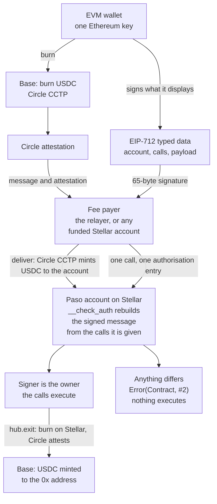

# Paso

**Every Ethereum address already has a Stellar account.**

Live on testnet: **https://paso-stellar.vercel.app** — [try it without a wallet](https://paso-stellar.vercel.app/app?demo=1), or see [every claim with its transaction](https://paso-stellar.vercel.app/proof).

## What and why

The dollars are on EVM chains. A Stellar account asks for a new wallet, a new seed phrase, XLM for reserves and a trustline before the first dollar arrives, and MetaMask's native Stellar support still creates a classic account with those costs (1 XLM, plus 0.5 XLM per trustline). Paso derives a Soroban contract account from the 20-byte Ethereum address itself. That account accepts only an EIP-712 signature from that address, and it rebuilds the signed message on chain from the calls being authorised: what the wallet displays is exactly what executes, or nothing does. USDC arrives from Base over Circle CCTP and a relayer pays the Stellar fees, so there is no new wallet, no seed phrase and no XLM.

Status: the hub and the account code are deployed on Stellar mainnet and on testnet. The whole path has run on both: Base to the account, on to another account, and back to Base, with real USDC on mainnet. On mainnet that was one run from the scripts. The web app and the relayer are set up for testnet only. [Limits](#limits) lists everything that is not done.

## See it

### Mainnet

One run with real USDC on Base and Stellar mainnet on 2026-10-12, for the owner `0x20806157d9607050204bbbCd37CE71498B35D46c`. Times are block and ledger close times, UTC.

| Time | What happened | Transaction |
|---|---|---|
| 17:42:43 | 1 USDC burned on Base for the owner's Stellar account | [`0x460008a2…`](https://basescan.org/tx/0x460008a250884ff32698bd849f2094f2217c8b613a3ce3c5041a44730194994c) |
| 17:44:32 | Delivered on Stellar: 0.99987 USDC in the account, which was not deployed yet. Circle kept 0.00013 | [`a742bf77…`](https://stellar.expert/explorer/public/tx/a742bf77748cc1d2fb25347996dea79fa4e3827d7005cf6391588874a44fe1a0) |
| 18:00:47 | The account deployed. Anyone may do this; the fee payer did | [`8da9a459…`](https://stellar.expert/explorer/public/tx/8da9a45941d661070efbbf0c0276f7d483488ce2e5003e478dc1f0feef57b6ea) |
| 18:00:52 | 0.1 USDC sent to the Stellar account of another Ethereum address, itself never deployed | [`85cb7efa…`](https://stellar.expert/explorer/public/tx/85cb7efa882a1cc6cc54c294bd7d60e5c7b6e47c8221ff7625fb44f6623e2322) |
| 18:00:57 | 0.5 USDC sent back to Base. One signature covers `hub.exit` and the USDC `transfer` nested in it | [`fccc2318…`](https://stellar.expert/explorer/public/tx/fccc2318b8322cc020fd0d6c0a84f05dea45a36725ae9ba24f36a6a7287d76c6) |
| 18:01:09 | 0.5 USDC minted on Base to the owner | [`0x5b713522…`](https://basescan.org/tx/0x5b713522befbbeeb702d9bb8d48e4fc13da7585b3222ec52e5e7296caf3e4776) |
| 18:01:12 | A USDC `approve` for amount `1`, signed by the owner: accepted | [`9f7172de…`](https://stellar.expert/explorer/public/tx/9f7172de421fe48032130cf76432432a4a1a3298e0003ff3763e759d3b0ba8a2) |
| 18:01:17 | A signature for amount `1`, submitted with amount `10000000000000`: refused | [`eb945398…`](https://stellar.expert/explorer/public/tx/eb94539839cba10012c01cea9453410d740d89194c2e99c4b33958aec144b6a3) |

The last transaction changed one argument after signing. The account contract rebuilt the message from the call it was given, recovered a signer that is not the owner, and returned `Error(Contract, #2)` (`BadSignature`). Nothing executed.

Circle attested the burn in 2 seconds and the exit in 7. The first delivery transaction was sent with the minimum fee and never reached a ledger; it was sent again with a higher bid, and the scripts now resend automatically. The steps from 18:00 on were run as a second part.

Every Stellar fee was paid by a separate account: 0.0658391 XLM for the delivery and 0.1124682 XLM for the five transactions after it. The owner's account paid none.

This run was made by `scripts/e2e.ts`. The web app and the relayer were not involved; they are set up for testnet only.

### Testnet

The same path on Base Sepolia and Stellar testnet, 32 seconds from the burn to the mint back on Base: burn [`0x43c00d27…`](https://sepolia.basescan.org/tx/0x43c00d27bf35c2288c160e6e1bfad424a206dc0e0b2d0ae901e7b20a88879b9e), delivery [`f7c95418…`](https://stellar.expert/explorer/testnet/tx/f7c95418993326f42b05c8a682e9dc3a9a7e18d0ad267b168eba09b1a40d23f1), transfer [`dc3db1dd…`](https://stellar.expert/explorer/testnet/tx/dc3db1dd76496889c53a0007d3017e6b0d8019848c4ebbe555f9899b76eadf63), exit [`6cae28f1…`](https://stellar.expert/explorer/testnet/tx/6cae28f1ea0f3d8020cfda61f75cfb6b8b13914fe859569d20c9e935a2e79a2f), mint [`0xd81b8b7e…`](https://sepolia.basescan.org/tx/0xd81b8b7e8f762910712494e3fba1b29144f2cef41a27081c44adb820ee5b137d), accepted [`b8a81489…`](https://stellar.expert/explorer/testnet/tx/b8a81489a2b20babc3ceadf6c9b22ba15965c725a6594b3413de6c4aadc91ac5), refused [`ded23530…`](https://stellar.expert/explorer/testnet/tx/ded23530dfc8d114a1350522e45b257170ed775738b0e85887f0e6667d52b181). [docs/VERIFY.md](docs/VERIFY.md) walks through it.

## How it works



Solid arrows: executed live on Base and Stellar mainnet and on their testnets, transactions linked under [Proof](#proof). A dashed arrow would mark a path that is built but not yet run live; none is left in this diagram.

1. **Derive.** The hub contract deploys accounts with the salt `12 zero bytes ‖ 20-byte Ethereum address`. The account address is the id of that contract, so it depends only on the network, the hub and the Ethereum address. `hub.address_of(owner)` returns it on chain; `twinAddress(owner, network)` in the SDK computes it with no network call. The address can receive USDC before anything is deployed. `hub.deploy(owner)` is open to anyone and repeating it changes nothing.
2. **Fund.** USDC is burned on Base through Circle's CCTP contracts. Circle attests the burn. Anyone can deliver the attested message on Stellar: `deliverWith` in the SDK does it from any funded account, and the relayer has a route for it. Circle's contracts decide where the USDC goes.
3. **Act.** The SDK simulates a call and gets the one authorisation entry the account must sign. It renders the entry as EIP-712 typed data. The wallet signs. A fee payer wraps the call and the signed entry in its own transaction. The Soroban host calls the account's `__check_auth`, which renders every call to text, hashes it as EIP-712, recovers the signer and compares it with the stored owner.
4. **Leave.** `hub.exit` sends USDC from the account back to Base over CCTP. One signature covers `exit` and the USDC `transfer` nested inside it.

The fee payer is the relayer (`POST /api/relay`) or any funded Stellar account (`submitWith` in the SDK). It pays and nothing else: it cannot change the call, and `pnpm e2e` runs without a relayer.

## What you sign

This is the message behind the [first call of the testnet example account](https://stellar.expert/explorer/testnet/tx/43a92797a315f742ef121ec607e9d2ca23b68e10eb6d2ce931f5e7f7f0ad6d90). `types` is left out here; it is in [docs/ENCODING.md](docs/ENCODING.md).

```json
{
  "domain": {
    "name": "Paso",
    "version": "1",
    "salt": "0xcee0302d59844d32bdca915c8203dd44b33fbb7edc19051ea37abedf28ecd472"
  },
  "primaryType": "Authorization",
  "message": {
    "account": "CCI3UVOB35NEJCTKPCLSPJVT745BNT2QNACV3QP46CRYTVD3QCOH2VME",
    "calls": [
      {
        "contract": "CBIELTK6YBZJU5UP2WWQEUCYKLPU6AUNZ2BQ4WWFEIE3USCIHMXQDAMA",
        "fn": "approve",
        "args": [
          "CCI3UVOB35NEJCTKPCLSPJVT745BNT2QNACV3QP46CRYTVD3QCOH2VME",
          "CBNSNERNVI7NW7JWDLOFJQJYMJC67EMVZLQONBBPWR4HLQMP53QGFOBO",
          "1",
          "5159846"
        ]
      }
    ],
    "payload": "0x57246257bd3aa74bb65b3bfdfdfd7d2093286f6d309e8df1f60d3d11b0f1f3e7"
  }
}
```

| Field | Meaning in this message |
|---|---|
| `domain.salt` | The Stellar network id: sha256 of the testnet passphrase. A signature for testnet is not valid on mainnet. |
| `account` | The account that checks the signature. A signature for one account is not valid for another. |
| `contract` | The contract being called: USDC on testnet. |
| `fn` | The function: `approve`. |
| `args` | From the account, to the hub, amount `1` (0.0000001 USDC), allowance valid until ledger `5159846`. |
| `payload` | The Soroban authorisation payload. It binds the network, a nonce, the last ledger at which the signature is accepted, and the full call tree. |

The EIP-712 digest of this message is `0xfc4623691cc7ce8a8104ed462f05dd5ad26af83865f63f7d2ed69710402f130f`. The signature in the transaction recovers to `0x7880DA9a52Af491f76421869d4e28DC0A4D1767C`, the owner stored in the account. `pnpm verify` reproduces both from public chain data.

A call that makes further calls on the account's behalf lists all of them. The testnet exit was signed as two calls:

```
calls[0]  hub   exit      account, 5000000, 6, 0x0000000000000000000000007880da9a52af491f76421869d4e28dc0a4d1767c, 0, 1000
calls[1]  USDC  transfer  account, hub, 5000000
```

Here `account`, `hub` and `USDC` stand for the three `C…` addresses, which the message spells out in full. The arguments of `exit` are the amount (0.5 USDC), the CCTP domain of Base, the recipient on Base padded to 32 bytes, the fee cap and the finality threshold.

The account contract never sees the JSON. It receives the calls from the host and builds the same text itself. If the text it builds differs in one character from what the wallet showed, the digest differs, the recovered address is not the owner, and the transaction fails.

## Proof

2026-10-12. Every transaction of the two runs is linked under [See it](#see-it).

**Mainnet: Stellar public network and Base**

- Hub contract: [`CDZCHMNS…AB7LJK`](https://stellar.expert/explorer/public/contract/CDZCHMNSAAIST5K2DNP4DP6H3DE4UJISUOMDFQTKD7IK6CD477AB7LJK), deployed in [`9285fcdb…`](https://stellar.expert/explorer/public/tx/9285fcdb5d3f065c196816810ff6af1ff453ece88824e5775bd4602154082426).
- Account code: wasm hash `2ee1ac08ca6407667db15bcffe75c8cbb4e41d95b2d047541b5dad133cfe75ee`, the same as on testnet, uploaded in [`eb90e5f9…`](https://stellar.expert/explorer/public/tx/eb90e5f911d097cbbaf724bed6ab670a7a2cf3843c4a1ffb89397ce34ce05135). Hub code uploaded in [`c3eca151…`](https://stellar.expert/explorer/public/tx/c3eca151541a5e66d2d7679a37492686cd5dd46a1c5f7c66c1f9f8bcb6139161).
- Account of `0x20806157d9607050204bbbCd37CE71498B35D46c`: [`CBWU43ND…XEZ7EPX`](https://stellar.expert/explorer/public/contract/CBWU43NDIBPC6SD2WKVNJH6A5ROHGMSDJWAVLCO3RITO5Q264XEZ7EPX). It received USDC in [`a742bf77…`](https://stellar.expert/explorer/public/tx/a742bf77748cc1d2fb25347996dea79fa4e3827d7005cf6391588874a44fe1a0) and was deployed later, in [`8da9a459…`](https://stellar.expert/explorer/public/tx/8da9a45941d661070efbbf0c0276f7d483488ce2e5003e478dc1f0feef57b6ea).
- Paid before it had an account, twice: the owner's own account above, and 0.1 USDC to `CCSLYO2GFX5G7STNB37YZ44KB7WLBB72UH5Z7CD3UUZ64RAU6AHT4LNX`, the never-deployed account of `0xEe67130Fa530c04b88D6Fd99fcc7D1D1494841f8`, in [`85cb7efa…`](https://stellar.expert/explorer/public/tx/85cb7efa882a1cc6cc54c294bd7d60e5c7b6e47c8221ff7625fb44f6623e2322).
- On Base: USDC approval [`0x53eb5943…`](https://basescan.org/tx/0x53eb5943435834ca70659f5bf3715e5c7d7f82c10516955083260a316920f469), burn [`0x460008a2…`](https://basescan.org/tx/0x460008a250884ff32698bd849f2094f2217c8b613a3ce3c5041a44730194994c), mint [`0x5b713522…`](https://basescan.org/tx/0x5b713522befbbeeb702d9bb8d48e4fc13da7585b3222ec52e5e7296caf3e4776).
- Refused on mainnet, amount changed after signing, submitted on purpose: [`eb945398…`](https://stellar.expert/explorer/public/tx/eb94539839cba10012c01cea9453410d740d89194c2e99c4b33958aec144b6a3), FAILED, result `txFailed, invokeHostFunctionTrapped`. Host log: `["failed account authentication with error", CBWU43ND…XEZ7EPX, Error(Contract, #2)]`. Error 2 is `BadSignature`.
- Scope: the contracts and one scripted run. The web app and the relayer have not run on mainnet.

**Testnet: deployment**

- Hub contract: [`CBNSNERN…QGFOBO`](https://stellar.expert/explorer/testnet/contract/CBNSNERNVI7NW7JWDLOFJQJYMJC67EMVZLQONBBPWR4HLQMP53QGFOBO), deployed in [`fdacf6ee…`](https://stellar.expert/explorer/testnet/tx/fdacf6ee2c1b428ab4d5773070ec2270036d3939865c6b01b902e83ad7d44b45). Hub code, 4,156 bytes, uploaded in [`cb039f10…`](https://stellar.expert/explorer/testnet/tx/cb039f10a642650601f91101d1ee1d388edad529071b2b61ac8dc351bc83f652).
- Account code, 7,837 bytes, uploaded in [`2d6baec6…`](https://stellar.expert/explorer/testnet/tx/2d6baec6ecf690266226141fe1a0bf747f58978be3537180416722180dfec96d).
- Example account: owner `0x7880DA9a52Af491f76421869d4e28DC0A4D1767C` has the account [`CCI3UVOB…OH2VME`](https://stellar.expert/explorer/testnet/contract/CCI3UVOB35NEJCTKPCLSPJVT745BNT2QNACV3QP46CRYTVD3QCOH2VME), deployed in [`e5fe8370…`](https://stellar.expert/explorer/testnet/tx/e5fe8370b67f0ba7d9e1f24f108824e3ecacad72663e73ffb03e79798a4050b4). A second `deploy` for the same owner changed nothing: [`b1e88787…`](https://stellar.expert/explorer/testnet/tx/b1e8878740ee55801bcdaddd5b8985acb29024212f1ac8f0134ad2735ec455b3).

**Testnet: signing**

- The example account's first call, a USDC `approve` authorised by an Ethereum signature: [`43a92797…`](https://stellar.expert/explorer/testnet/tx/43a92797a315f742ef121ec607e9d2ca23b68e10eb6d2ce931f5e7f7f0ad6d90), SUCCESS, ledger 5159648.
- Refused on chain: [`ded23530…`](https://stellar.expert/explorer/testnet/tx/ded23530dfc8d114a1350522e45b257170ed775738b0e85887f0e6667d52b181), FAILED, ledger 5160302, host log `["failed account authentication with error", CCI3UVOB…OH2VME, Error(Contract, #2)]`. Two earlier ones: [`32a1c98d…`](https://stellar.expert/explorer/testnet/tx/32a1c98dd9f14ffcae41448cdacd525f5f76b073aa695cc9a3c018bd56ade1b3) and [`e8a91143…`](https://stellar.expert/explorer/testnet/tx/e8a91143725b27bdd36fd997b6262d3196048e0edf4793e9bbf5c388bc0e9d7a).
- Paid before it had an account: 0.1 USDC to `CAT44DMN6RQ44HZDEBJUSBWRJ3YOICUNPFHYIG6FSEUWFEBUYWIVY7FJ`, the never-deployed account of `0xC801b29BC8eE267cA2C353fF146FFa642Cc2BE85`, in [`dc3db1dd…`](https://stellar.expert/explorer/testnet/tx/dc3db1dd76496889c53a0007d3017e6b0d8019848c4ebbe555f9899b76eadf63).

**Testnet: through the web app and the relayer**

The app's transactions were signed in the browser with its demo key, not with a wallet extension.

- `POST /api/relay`: from the end-to-end script, an account deployed in [`0ec43de4…`](https://stellar.expert/explorer/testnet/tx/0ec43de437e650f7db5aa8bf942bf2f7460a168020f17ddfceae7c9f51febda9) and its call relayed in [`5a6cf2ec…`](https://stellar.expert/explorer/testnet/tx/5a6cf2ece6050bcd5d96d59b71162f1de514119ae8acbc99adbcbc37158bb890). From the app, a 0.1 USDC send relayed in [`ee5ca8c9…`](https://stellar.expert/explorer/testnet/tx/ee5ca8c9244c23c942ff2f2a8a280130bae2c58b66a67e272c40857909f70a0d).
- `POST /api/demo/fund` and `POST /api/cctp/deliver`: faucet burn on Base Sepolia [`0xb3474363…`](https://sepolia.basescan.org/tx/0xb3474363c81c3f1458423a1003f38c24deba51a17b5700cb71b386262b5854dd), delivered by the relayer in [`0e906ad1…`](https://stellar.expert/explorer/testnet/tx/0e906ad1652c2f5c2635d0082085d7b13bbfe309856944bf7a062239987d6669).
- `POST /api/cctp/complete`: exit from the app [`f568145f…`](https://stellar.expert/explorer/testnet/tx/f568145fef34bceac94cfd5286c8a461c3315462f548fb451606434d122a035a), minted on Base Sepolia by the relayer in [`0x126161a9…`](https://sepolia.basescan.org/tx/0x126161a91176872959d8141ee6d449c93f0f0ae33d82dfc3d62377acf7467f94).
- A send changed after signing was refused by the relayer's simulation with `bad_signature` (HTTP 422). Nothing was sent, so there is no transaction to link.

**Fees charged on mainnet**

| Transaction | XLM |
|---|---|
| Upload the account code ([`eb90e5f9…`](https://stellar.expert/explorer/public/tx/eb90e5f911d097cbbaf724bed6ab670a7a2cf3843c4a1ffb89397ce34ce05135)) | 9.3681676 |
| Upload the hub code ([`c3eca151…`](https://stellar.expert/explorer/public/tx/c3eca151541a5e66d2d7679a37492686cd5dd46a1c5f7c66c1f9f8bcb6139161)) | 5.9556408 |
| Deploy the hub ([`9285fcdb…`](https://stellar.expert/explorer/public/tx/9285fcdb5d3f065c196816810ff6af1ff453ece88824e5775bd4602154082426)) | 0.0530724 |
| Deliver a CCTP message ([`a742bf77…`](https://stellar.expert/explorer/public/tx/a742bf77748cc1d2fb25347996dea79fa4e3827d7005cf6391588874a44fe1a0)) | 0.0658391 |
| Deploy an account ([`8da9a459…`](https://stellar.expert/explorer/public/tx/8da9a45941d661070efbbf0c0276f7d483488ce2e5003e478dc1f0feef57b6ea)) | 0.0262901 |
| USDC transfer to an address with no balance yet ([`85cb7efa…`](https://stellar.expert/explorer/public/tx/85cb7efa882a1cc6cc54c294bd7d60e5c7b6e47c8221ff7625fb44f6623e2322)) | 0.0398373 |
| Exit to Base ([`fccc2318…`](https://stellar.expert/explorer/public/tx/fccc2318b8322cc020fd0d6c0a84f05dea45a36725ae9ba24f36a6a7287d76c6)) | 0.0426572 |
| `approve` ([`9f7172de…`](https://stellar.expert/explorer/public/tx/9f7172de421fe48032130cf76432432a4a1a3298e0003ff3763e759d3b0ba8a2)) | 0.0022547 |
| The refused transaction ([`eb945398…`](https://stellar.expert/explorer/public/tx/eb94539839cba10012c01cea9453410d740d89194c2e99c4b33958aec144b6a3)) | 0.0014289 |

All of it was paid by `GAS65I36DQSMBSEZRN5KXDJMRCNEWNEX2VANOQB2QZQX5JX2X6D4SQBM`. The uploads and the hub deployment are paid once per network. On Base the owner paid the gas of the burn and of the mint.

The relayer refuses any transaction whose resource fee is above 0.5 XLM, and stops at 50 XLM of fees in 24 hours. Both limits are settings.

**Tests**

- 29 for the account contract and 15 for the hub: `pnpm test:contracts`.
- 200 for the SDK offline: `PASO_OFFLINE=1 pnpm test:sdk`. Without the flag, 8 more read testnet.
- 321 for the web app and the relayer offline: `PASO_OFFLINE=1 pnpm test:web`. 23 more send testnet transactions and need keys.
- 11 signing vectors in [`fixtures/vectors.json`](fixtures/vectors.json). The Rust suite and the TypeScript suite both check the rendered text, the digest and the recovered signer of every vector.
- The order in which the host lists calls to `__check_auth` (root first, then sub-calls depth first) is checked by a contract test that goes through the real host path: `host_lists_contexts_root_first_then_depth_first`.

[docs/CLAIMS.md](docs/CLAIMS.md) lists every claim with its evidence, and what is not claimed.

## Verify it yourself

After `pnpm install`:

```sh
# 1. Rebuild the signed message from the mainnet transfer, recover the signer, compare with the account's owner. Exits 0.
pnpm verify 85cb7efa882a1cc6cc54c294bd7d60e5c7b6e47c8221ff7625fb44f6623e2322 --network mainnet

# 2. The same check on the transaction refused on mainnet. The recovered signer is not the owner. Exits 1.
pnpm verify eb94539839cba10012c01cea9453410d740d89194c2e99c4b33958aec144b6a3 --network mainnet

# 3. Build both contracts and run their tests: 29 + 15.
pnpm test:contracts
```

Commands 1 and 2 need Node.js and pnpm only. Command 3 needs Rust and the Stellar CLI.

Without `--network mainnet` the same command checks testnet: `pnpm verify 43a92797a315f742ef121ec607e9d2ca23b68e10eb6d2ce931f5e7f7f0ad6d90` exits 0 and `pnpm verify ded23530dfc8d114a1350522e45b257170ed775738b0e85887f0e6667d52b181` exits 1.

`pnpm verify` reads a public Soroban RPC, which keeps about a week of transactions. After that, `pnpm e2e --stellar-only` makes a fresh accepted call and a fresh refusal on testnet with a new key.

[docs/VERIFY.md](docs/VERIFY.md) walks through every check.

## Run it

### Prerequisites

| Tool | Version |
|---|---|
| Node.js | 22.12 or newer |
| pnpm | 12.11.2 |
| Rust | stable, with the `wasm32v1-none` target (`rust-toolchain.toml` selects both; built with 1.99.0) |
| Stellar CLI | 28.1.0 was used for `stellar contract build` and the deployment |

The contracts use `soroban-sdk` 29.0.0.

### Install, build, test

```sh
git clone https://github.com/RaYYeR220/paso
cd paso
pnpm install

pnpm build:contracts   # target/wasm32v1-none/release/paso_account.wasm and paso_hub.wasm
pnpm test:contracts    # 29 account tests, 15 hub tests

pnpm build:sdk
PASO_OFFLINE=1 pnpm test:sdk   # 200 tests
PASO_OFFLINE=1 pnpm test:web   # 321 tests: the relayer and the web app's logic
```

`PASO_OFFLINE=1` skips every test that reaches a network. Without it, `pnpm test:sdk` runs 8 more tests that read Stellar testnet, and 2 that need `PASO_E2E_OWNER_KEY`. `pnpm test:web` has 23 more tests that send testnet transactions; they need `RELAYER_SECRET` and `PASO_E2E_OWNER_KEY`.

### Environment

Copy `apps/web/.env.example` to `apps/web/.env.local`. The dev server and the web tests read that file; so do the scripts on testnet. On mainnet the scripts read the environment alone.

| Variable | Required | Purpose |
|---|---|---|
| `PASO_NETWORK` | no | `testnet` or `mainnet`. Defaults to `testnet`. |
| `PASO_ALLOW_MAINNET` | for mainnet | Must be `true` for `PASO_NETWORK=mainnet` to be accepted. Real funds are never used by default. |
| `RELAYER_SECRET` | yes | Secret key (`S…`) of the Stellar account that pays the fee of every relayed transaction. It pays fees and nothing else. |
| `DEMO_PAYER_PRIVATE_KEY` | no | Private key (`0x…`) of the server's account on Base. It burns for the testnet faucet and pays the gas of mints that finish a transfer back to Base. Empty switches both off. |
| `STELLAR_RPC_URL` | no | Soroban RPC endpoint. Defaults to the public endpoint of the network. |
| `BASE_RPC_URL` | no | RPC endpoint for Base. Defaults to the chain's public endpoint. |
| `RELAYER_MAX_RESOURCE_FEE` | no | The most one transaction of the relayer may cost in resource fees, in stroops. Defaults to `5000000` (0.5 XLM). |
| `RELAYER_MAX_DAILY_FEES` | no | The most the relayer spends on fees in any 24 hours, in stroops. Defaults to `500000000` (50 XLM). |
| `DEMO_FUND_PER_IP_PER_HOUR` | no | Faucet requests one caller address may make per hour. Defaults to `5`. |
| `DEMO_FUND_PER_OWNER_PER_DAY` | no | Faucet requests for one owner per day. Defaults to `2`. |
| `DEMO_FUND_PER_DAY` | no | Faucet payouts in any 24 hours, whoever asks. Defaults to `50`. |
| `DEMO_FUND_PAYER_FLOOR` | no | USDC the faucet's payer keeps, in 6-decimal units. No payout takes it below this. Defaults to `2000000` (2 USDC). |
| `BASE_MINTS_PER_CALLER_PER_HOUR` | no | Mints on Base the server pays the gas for, per caller in an hour. Defaults to `10`. |
| `BASE_MINTS_PER_DAY` | no | Mints on Base the server pays the gas for in any 24 hours, whoever asks. Defaults to `100`. |
| `BASE_MINT_PAYER_ETH_FLOOR` | no | ETH the server's account on Base keeps, in wei. Below it the server stops paying for mints. Defaults to `100000000000000` (0.0001 ETH). |
| `BASE_MINT_MAX_FEE_PER_GAS` | no | The most the server offers per unit of gas for a mint on Base, in wei. While Base asks more, it does not mint. Defaults to `250000000` (0.25 gwei). |
| `PAY_BASE_MINTS_ON_MAINNET` | no | Must be `true`, on top of `PASO_ALLOW_MAINNET`, for the server to pay for mints on Base on mainnet. Off by default: any wallet can submit the mint. |
| `PASO_E2E_OWNER_KEY` | tests, scripts | Ethereum private key (`0x…`) of an owner whose account is deployed on testnet. |
| `PASO_E2E_SOURCE_SECRET` | tests, scripts | Secret key (`S…`) of any funded Stellar testnet account. It may be the relayer's. |
| `PASO_E2E_PAYER_KEY` | scripts, optional | Ethereum private key (`0x…`) that pays the burn on Base Sepolia. Defaults to `DEMO_PAYER_PRIVATE_KEY`, then `PASO_E2E_OWNER_KEY`. |

### Dev server

```sh
pnpm build:sdk                 # the web app imports the built SDK
pnpm --filter @paso/web dev    # http://localhost:3000
```

Pages: the landing page at `/`, the app at `/app`, an address lookup at `/lookup`, and the proof page at `/proof`.

The server exposes the relayer API:

| Route | What it does |
|---|---|
| `POST /api/relay` | Wraps one signed call in a transaction and pays its fee. Deploys the account first if needed. |
| `POST /api/deploy` | Deploys the account of an Ethereum address. |
| `POST /api/cctp/deliver` | Takes the hash of a CCTP burn, asks Circle for the attestation and delivers it on Stellar. |
| `POST /api/cctp/complete` | Takes the hash of an exit on Stellar. Once Circle has attested it, the server's account on Base submits the mint and pays its gas. On mainnet it answers 404 unless set up to pay. |
| `POST /api/demo/fund` | Testnet only: burns 1 test USDC on Base Sepolia for an owner's account. |
| `GET /api/health` | Network, hub, relayer address and balances. |

### Scripts

```sh
pnpm e2e --stellar-only            # testnet: a fresh key, a first call, then the refusal on chain; needs PASO_E2E_SOURCE_SECRET
pnpm e2e                           # testnet: Base Sepolia to the account, a transfer, back to Base, the refusal; needs funded keys
pnpm e2e --relayer <url>           # the same, with a relayer paying the Stellar fees
pnpm e2e --network mainnet --dry-run   # every read and simulation of a mainnet run and what it would cost; sends nothing
pnpm e2e --network mainnet         # the same journey with real funds; the owner key pays on Base, PASO_E2E_SOURCE_SECRET on Stellar
pnpm verify <stellar tx hash> [--network mainnet]
scripts/deploy.sh <testnet|mainnet>
```

A run of `pnpm e2e` that stops half way says how to pick it up: `--resume-burn <base tx>` continues from a burn that exists, `--skip-fund` starts from the USDC the account already holds, and `--skip-transfer`, `--resume-exit <stellar tx>` and `--skip-exit` do the same for the later steps. On mainnet the script sends Stellar transactions with a bid above the minimum, and sends one again with a higher bid when no ledger took it.

`scripts/deploy.sh` builds both contracts, uploads their code, deploys the hub and writes `deployments/<network>.json`. It simulates every step first and prints the fees in XLM. On mainnet it stops after printing that plan unless `PASO_CONFIRM_MAINNET` is set to the printed total in whole XLM, and it never spends past that number. Mainnet accepts only the build that runs on testnet. `PASO_DEPLOYER` names the stellar-cli identity that pays.

A new hub means new account addresses for everyone. Deploy one hub per network.

### Use the SDK

```ts
import { parseStellarAmount, prepare, relay, sign, twinAddress } from "@paso/sdk";

// owner: the 0x address. walletClient: a viem wallet client with that account set.
const account = twinAddress(owner, "testnet"); // C…, no network call

// Send 1.5 USDC to the Stellar account of another Ethereum address.
const prepared = await prepare(
  { kind: "transfer", to: "0x70997970C51812dc3A010C7d01b50e0d17dc79C8", amount: parseStellarAmount("1.5") },
  { owner, network: "testnet" },
);
const signed = await sign(prepared, walletClient); // the wallet shows prepared.calls
const { hash } = await relay(signed, "https://example.org/api/relay");
```

`@paso/sdk` is a workspace package and is not published to npm. Its API is documented in [packages/sdk/README.md](packages/sdk/README.md).

## Repository layout

```
contracts/account   Soroban contract account: owner, __check_auth, EIP-712 hashing, argument rendering
contracts/hub       Deploys accounts at derived addresses; exit() sends USDC back over CCTP
packages/sdk        TypeScript: derive, render, typed data, sign, fund from Base, relay client, reads
apps/web            Next.js app: the pages, the relayer API (app/api, lib/server) and their tests
scripts             End-to-end run (e2e.ts), verification (verify.ts), deployment (deploy.sh)
fixtures            vectors.json: signing vectors shared by the Rust and TypeScript tests; gen/ writes them
deployments         testnet.json and mainnet.json: hub id, account wasm hash, Circle contract ids
docs                ENCODING.md, SECURITY.md, VERIFY.md, CLAIMS.md
```

## Limits

- **Mainnet covers the contracts and one scripted run.** The hub and the account code are on Stellar mainnet, and one journey ran there with 1 USDC. The web app and the relayer are set up for testnet only.
- **One source chain:** Base, and Base Sepolia on testnet. Other CCTP chains are untested, and Base is the only EVM chain configured in the SDK.
- **No key rotation and no recovery.** The owner is set once in the constructor. Lose the Ethereum key and the account is lost.
- **No upgrade and no administrator.** Neither contract has an admin function. A bug cannot be patched in place.
- **Externally owned accounts only.** The account checks one 65-byte secp256k1 signature. ERC-1271 smart-contract wallets cannot sign for it.
- **Wallet extensions are untested.** The signatures in the linked transactions were made by scripts, or by the web app's demo key in the browser, through viem's EIP-712 signer. No wallet extension such as MetaMask has been exercised live, so how a given wallet lays the message out on screen has not been checked. Neither has the app's ENS lookup.
- **Amounts and contracts are shown raw.** `5000000` is 0.5 USDC, and a contract is its `C…` address. The message carries no decimals, token symbols or names.
- **Nested arguments are bound by hash, not shown as text.** Vectors, maps, structs, 256-bit integers, timepoints, durations and muxed addresses appear as `xdr:<sha256>`.
- **Text does not carry types.** The number `5` and the string `"5"` read the same in the wallet. The payload still binds the exact values.
- **The signature's expiry is not shown as text.** It is inside `payload`. The SDK sets it to 120 ledgers, about ten minutes.
- **One signature, one authorisation tree.** A call that needs two separate authorisations from the account is refused by the SDK.
- **USDC crosses with 6 decimals.** Stellar USDC has 7. `exit` rejects an amount or fee cap with a non-zero seventh decimal.
- **Addresses depend on the hub.** A different hub contract gives every owner a different account address. An owner's mainnet and testnet addresses differ.
- **The relayer can decline.** It cannot move funds or change a signed call, and anyone can submit instead. Its limits are kept in memory and reset when the server restarts.
- **A transaction that bids the minimum fee can be left out of every ledger.** It happened to the first mainnet delivery. The scripts resend with a higher bid.
- **A signature whose `r` is not a valid curve point aborts in the host** instead of returning a typed error. The transaction still fails.
- **No TTL extension logic in the contracts.** Archived entries are restored automatically by the network when used.
- **Unaudited.**

[docs/SECURITY.md](docs/SECURITY.md) has the threat model.

## Prior art

- EIP-712 verification inside a Soroban `__check_auth` exists in LayerZero's OneSig multisig for Stellar.
- OpenZeppelin's Stellar smart accounts ship ed25519 and WebAuthn verifiers.
- MetaMask's own Stellar support is a different thing: a classic account that needs 1 XLM plus 0.5 XLM per trustline, in MetaMask only.
- The bridge is Circle's CCTP. Paso adds no bridge contract for incoming USDC; it uses Circle's TokenMessengerMinter, MessageTransmitter and CctpForwarder.

Paso's part: an account derived from the Ethereum address itself, with the displayed message rebuilt on chain from the calls being authorised.

## License

[MIT](LICENSE). Built for the Find Your Way hackathon.
