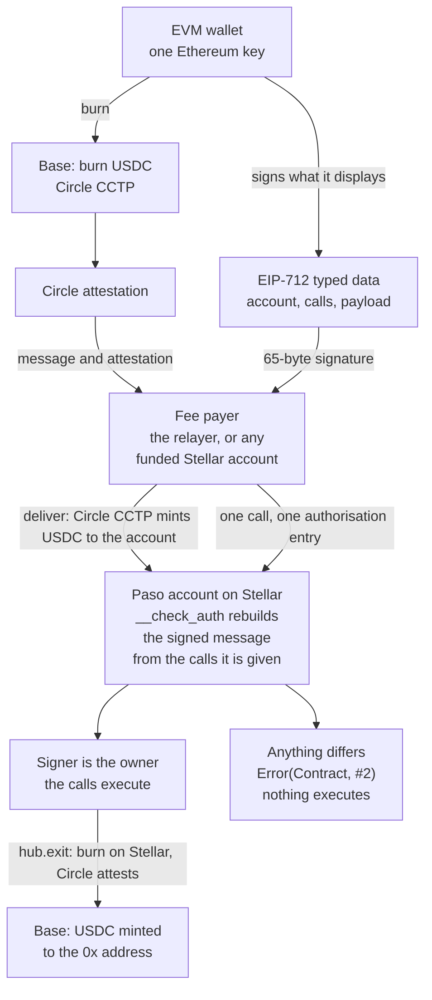

# Paso

**Every Ethereum address already has a Stellar account.**

## What and why

The dollars are on EVM chains. A Stellar account asks for a new wallet, a new seed phrase, XLM for reserves and a trustline before the first dollar arrives, and MetaMask's native Stellar support still creates a classic account with those costs (1 XLM, plus 0.5 XLM per trustline). Paso derives a Soroban contract account from the 20-byte Ethereum address itself. That account accepts only an EIP-712 signature from that address, and it rebuilds the signed message on chain from the calls being authorised: what the wallet displays is exactly what executes, or nothing does. USDC arrives from Base over Circle CCTP and a relayer pays the Stellar fees, so there is no new wallet, no seed phrase and no XLM.

Status: deployed on Stellar testnet. The whole path has been executed live: Base Sepolia to the account, on to another account, and back to Base. Nothing is on mainnet. [Limits](#limits) lists everything that is not done.

## See it

One run on Base Sepolia and Stellar testnet on 2026-10-12, for the owner `0x7880DA9a52Af491f76421869d4e28DC0A4D1767C`. Times are block and ledger close times, UTC.

| Time | What happened | Transaction |
|---|---|---|
| 17:10:58 | 1 USDC burned on Base Sepolia for the owner's Stellar account | [`0x43c00d27…`](https://sepolia.basescan.org/tx/0x43c00d27bf35c2288c160e6e1bfad424a206dc0e0b2d0ae901e7b20a88879b9e) |
| 17:11:07 | Delivered on Stellar. The account holds 0.99987 USDC; Circle kept 0.00013 | [`f7c95418…`](https://stellar.expert/explorer/testnet/tx/f7c95418993326f42b05c8a682e9dc3a9a7e18d0ad267b168eba09b1a40d23f1) |
| 17:11:12 | 0.1 USDC sent to the Stellar account of another Ethereum address. That account was never deployed | [`dc3db1dd…`](https://stellar.expert/explorer/testnet/tx/dc3db1dd76496889c53a0007d3017e6b0d8019848c4ebbe555f9899b76eadf63) |
| 17:11:17 | 0.5 USDC sent back to Base. One signature covers `hub.exit` and the USDC `transfer` nested in it | [`6cae28f1…`](https://stellar.expert/explorer/testnet/tx/6cae28f1ea0f3d8020cfda61f75cfb6b8b13914fe859569d20c9e935a2e79a2f) |
| 17:11:30 | 0.5 USDC minted on Base Sepolia to the owner | [`0xd81b8b7e…`](https://sepolia.basescan.org/tx/0xd81b8b7e8f762910712494e3fba1b29144f2cef41a27081c44adb820ee5b137d) |
| 17:11:32 | A USDC `approve` for amount `1`, signed by the owner: accepted | [`b8a81489…`](https://stellar.expert/explorer/testnet/tx/b8a81489a2b20babc3ceadf6c9b22ba15965c725a6594b3413de6c4aadc91ac5) |
| 17:11:37 | A signature for amount `1`, submitted with amount `10000000000000`: refused | [`ded23530…`](https://stellar.expert/explorer/testnet/tx/ded23530dfc8d114a1350522e45b257170ed775738b0e85887f0e6667d52b181) |

From the burn on Base to the mint back on Base: 32 seconds. Every Stellar fee was paid by a separate account; the owner's account paid none.

The last transaction changed one argument after signing. The account contract rebuilt the message from the call it was given, recovered a signer that is not the owner, and returned `Error(Contract, #2)` (`BadSignature`). Nothing executed.

## How it works



Solid arrows: executed live on Base Sepolia and Stellar testnet, transactions linked under [Proof](#proof). A dashed arrow would mark a path that is built but not yet run live; none is left in this diagram.

1. **Derive.** The hub contract deploys accounts with the salt `12 zero bytes ‖ 20-byte Ethereum address`. The account address is the id of that contract, so it depends only on the network, the hub and the Ethereum address. `hub.address_of(owner)` returns it on chain; `twinAddress(owner, network)` in the SDK computes it with no network call. The address can receive USDC before anything is deployed. `hub.deploy(owner)` is open to anyone and repeating it changes nothing.
2. **Fund.** USDC is burned on Base through Circle's CCTP contracts. Circle attests the burn. Anyone can deliver the attested message on Stellar: `deliverWith` in the SDK does it from any funded account, and the relayer has a route for it. Circle's contracts decide where the USDC goes.
3. **Act.** The SDK simulates a call and gets the one authorisation entry the account must sign. It renders the entry as EIP-712 typed data. The wallet signs. A fee payer wraps the call and the signed entry in its own transaction. The Soroban host calls the account's `__check_auth`, which renders every call to text, hashes it as EIP-712, recovers the signer and compares it with the stored owner.
4. **Leave.** `hub.exit` sends USDC from the account back to Base over CCTP. One signature covers `exit` and the USDC `transfer` nested inside it.

The fee payer is the relayer (`POST /api/relay`) or any funded Stellar account (`submitWith` in the SDK). It pays and nothing else: it cannot change the call, and `pnpm e2e` runs without a relayer.

## What you sign

This is the message behind the [example account's first call](https://stellar.expert/explorer/testnet/tx/43a92797a315f742ef121ec607e9d2ca23b68e10eb6d2ce931f5e7f7f0ad6d90). `types` is left out here; it is in [docs/ENCODING.md](docs/ENCODING.md).

```json
{
  "domain": {
    "name": "Paso",
    "version": "1",
    "salt": "0xcee0302d59844d32bdca915c8203dd44b33fbb7edc19051ea37abedf28ecd472"
  },
  "primaryType": "Authorization",
  "message": {
    "account": "CCI3UVOB35NEJCTKPCLSPJVT745BNT2QNACV3QP46CRYTVD3QCOH2VME",
    "calls": [
      {
        "contract": "CBIELTK6YBZJU5UP2WWQEUCYKLPU6AUNZ2BQ4WWFEIE3USCIHMXQDAMA",
        "fn": "approve",
        "args": [
          "CCI3UVOB35NEJCTKPCLSPJVT745BNT2QNACV3QP46CRYTVD3QCOH2VME",
          "CBNSNERNVI7NW7JWDLOFJQJYMJC67EMVZLQONBBPWR4HLQMP53QGFOBO",
          "1",
          "5159846"
        ]
      }
    ],
    "payload": "0x57246257bd3aa74bb65b3bfdfdfd7d2093286f6d309e8df1f60d3d11b0f1f3e7"
  }
}
```

| Field | Meaning in this message |
|---|---|
| `domain.salt` | The Stellar network id: sha256 of the testnet passphrase. A signature for testnet is not valid on mainnet. |
| `account` | The account that checks the signature. A signature for one account is not valid for another. |
| `contract` | The contract being called: USDC on testnet. |
| `fn` | The function: `approve`. |
| `args` | From the account, to the hub, amount `1` (0.0000001 USDC), allowance valid until ledger `5159846`. |
| `payload` | The Soroban authorisation payload. It binds the network, a nonce, the last ledger at which the signature is accepted, and the full call tree. |

The EIP-712 digest of this message is `0xfc4623691cc7ce8a8104ed462f05dd5ad26af83865f63f7d2ed69710402f130f`. The signature in the transaction recovers to `0x7880DA9a52Af491f76421869d4e28DC0A4D1767C`, the owner stored in the account. `pnpm verify` reproduces both from public chain data.

A call that makes further calls on the account's behalf lists all of them. The exit in the table above was signed as two calls:

```
calls[0]  hub   exit      account, 5000000, 6, 0x0000000000000000000000007880da9a52af491f76421869d4e28dc0a4d1767c, 0, 1000
calls[1]  USDC  transfer  account, hub, 5000000
```

Here `account`, `hub` and `USDC` stand for the three `C…` addresses, which the message spells out in full. The arguments of `exit` are the amount (0.5 USDC), the CCTP domain of Base, the recipient on Base padded to 32 bytes, the fee cap and the finality threshold.

The account contract never sees the JSON. It receives the calls from the host and builds the same text itself. If the text it builds differs in one character from what the wallet showed, the digest differs, the recovered address is not the owner, and the transaction fails.

## Proof

Stellar testnet and Base Sepolia, 2026-10-12.

**Deployment**

- Hub contract: [`CBNSNERN…QGFOBO`](https://stellar.expert/explorer/testnet/contract/CBNSNERNVI7NW7JWDLOFJQJYMJC67EMVZLQONBBPWR4HLQMP53QGFOBO), deployed in [`fdacf6ee…`](https://stellar.expert/explorer/testnet/tx/fdacf6ee2c1b428ab4d5773070ec2270036d3939865c6b01b902e83ad7d44b45). Hub code, 4,156 bytes, uploaded in [`cb039f10…`](https://stellar.expert/explorer/testnet/tx/cb039f10a642650601f91101d1ee1d388edad529071b2b61ac8dc351bc83f652).
- Account code: wasm hash `2ee1ac08ca6407667db15bcffe75c8cbb4e41d95b2d047541b5dad133cfe75ee`, 7,837 bytes, uploaded in [`2d6baec6…`](https://stellar.expert/explorer/testnet/tx/2d6baec6ecf690266226141fe1a0bf747f58978be3537180416722180dfec96d).
- Example account: owner `0x7880DA9a52Af491f76421869d4e28DC0A4D1767C` has the account [`CCI3UVOB…OH2VME`](https://stellar.expert/explorer/testnet/contract/CCI3UVOB35NEJCTKPCLSPJVT745BNT2QNACV3QP46CRYTVD3QCOH2VME), deployed in [`e5fe8370…`](https://stellar.expert/explorer/testnet/tx/e5fe8370b67f0ba7d9e1f24f108824e3ecacad72663e73ffb03e79798a4050b4). A second `deploy` for the same owner changed nothing: [`b1e88787…`](https://stellar.expert/explorer/testnet/tx/b1e8878740ee55801bcdaddd5b8985acb29024212f1ac8f0134ad2735ec455b3).

**Signing**

- The example account's first call, a USDC `approve` authorised by an Ethereum signature: [`43a92797…`](https://stellar.expert/explorer/testnet/tx/43a92797a315f742ef121ec607e9d2ca23b68e10eb6d2ce931f5e7f7f0ad6d90), SUCCESS, ledger 5159648.
- Through the relayer API: an account deployed in [`0ec43de4…`](https://stellar.expert/explorer/testnet/tx/0ec43de437e650f7db5aa8bf942bf2f7460a168020f17ddfceae7c9f51febda9) and its call relayed in [`5a6cf2ec…`](https://stellar.expert/explorer/testnet/tx/5a6cf2ece6050bcd5d96d59b71162f1de514119ae8acbc99adbcbc37158bb890), SUCCESS, ledger 5160022.
- Refused on chain, amount changed after signing, submitted on purpose: [`ded23530…`](https://stellar.expert/explorer/testnet/tx/ded23530dfc8d114a1350522e45b257170ed775738b0e85887f0e6667d52b181), FAILED, ledger 5160302, result `txFailed, invokeHostFunctionTrapped`. Host log: `["failed account authentication with error", CCI3UVOB…OH2VME, Error(Contract, #2)]`. Error 2 is `BadSignature`. Two earlier ones: [`32a1c98d…`](https://stellar.expert/explorer/testnet/tx/32a1c98dd9f14ffcae41448cdacd525f5f76b073aa695cc9a3c018bd56ade1b3) and [`e8a91143…`](https://stellar.expert/explorer/testnet/tx/e8a91143725b27bdd36fd997b6262d3196048e0edf4793e9bbf5c388bc0e9d7a).

**Across chains**

- Base Sepolia to Stellar: USDC approval [`0x488a7aa0…`](https://sepolia.basescan.org/tx/0x488a7aa038e69448b0cc83701b3dd4295904400a4622df64f5d18f48653cab4b), burn of 1 USDC [`0x43c00d27…`](https://sepolia.basescan.org/tx/0x43c00d27bf35c2288c160e6e1bfad424a206dc0e0b2d0ae901e7b20a88879b9e) through Circle's CctpForwarder route as a Fast Transfer, delivery on Stellar [`f7c95418…`](https://stellar.expert/explorer/testnet/tx/f7c95418993326f42b05c8a682e9dc3a9a7e18d0ad267b168eba09b1a40d23f1). Circle attested the burn in 7 seconds.
- Paid before it had an account: 0.1 USDC to `CAT44DMN6RQ44HZDEBJUSBWRJ3YOICUNPFHYIG6FSEUWFEBUYWIVY7FJ`, the never-deployed account of `0xC801b29BC8eE267cA2C353fF146FFa642Cc2BE85`, in [`dc3db1dd…`](https://stellar.expert/explorer/testnet/tx/dc3db1dd76496889c53a0007d3017e6b0d8019848c4ebbe555f9899b76eadf63).
- Stellar back to Base: exit [`6cae28f1…`](https://stellar.expert/explorer/testnet/tx/6cae28f1ea0f3d8020cfda61f75cfb6b8b13914fe859569d20c9e935a2e79a2f), attested in 9 seconds, minted on Base Sepolia in [`0xd81b8b7e…`](https://sepolia.basescan.org/tx/0xd81b8b7e8f762910712494e3fba1b29144f2cef41a27081c44adb820ee5b137d).

**Fees charged to the fee payer**

| Transaction | XLM |
|---|---|
| Deploy an account ([`0ec43de4…`](https://stellar.expert/explorer/testnet/tx/0ec43de437e650f7db5aa8bf942bf2f7460a168020f17ddfceae7c9f51febda9)) | 0.010577 |
| `approve` ([`5a6cf2ec…`](https://stellar.expert/explorer/testnet/tx/5a6cf2ece6050bcd5d96d59b71162f1de514119ae8acbc99adbcbc37158bb890)) | 0.0020918 |
| Deliver a CCTP message ([`f7c95418…`](https://stellar.expert/explorer/testnet/tx/f7c95418993326f42b05c8a682e9dc3a9a7e18d0ad267b168eba09b1a40d23f1)) | 0.0756425 |
| USDC transfer to an address with no balance yet ([`dc3db1dd…`](https://stellar.expert/explorer/testnet/tx/dc3db1dd76496889c53a0007d3017e6b0d8019848c4ebbe555f9899b76eadf63)) | 0.0633319 |
| Exit to Base ([`6cae28f1…`](https://stellar.expert/explorer/testnet/tx/6cae28f1ea0f3d8020cfda61f75cfb6b8b13914fe859569d20c9e935a2e79a2f)) | 0.0659997 |

The relayer refuses any transaction whose resource fee is above 0.5 XLM, and stops at 50 XLM of fees in 24 hours. Both limits are settings.

**Tests**

- 29 for the account contract and 15 for the hub: `pnpm test:contracts`.
- 189 for the SDK: `pnpm test:sdk`.
- 87 for the relayer offline, and 21 more that send testnet transactions: `pnpm test:web`.
- 11 signing vectors in [`fixtures/vectors.json`](fixtures/vectors.json). The Rust suite and the TypeScript suite both check the rendered text, the digest and the recovered signer of every vector.
- The order in which the host lists calls to `__check_auth` (root first, then sub-calls depth first) is checked by a contract test that goes through the real host path: `host_lists_contexts_root_first_then_depth_first`.

[docs/CLAIMS.md](docs/CLAIMS.md) lists every claim with its evidence, and what is not claimed.

## Verify it yourself

After `pnpm install`:

```sh
# 1. Rebuild the signed message from a transaction, recover the signer, compare with the account's owner. Exits 0.
pnpm verify 43a92797a315f742ef121ec607e9d2ca23b68e10eb6d2ce931f5e7f7f0ad6d90

# 2. The same check on the refused transaction. The recovered signer is not the owner. Exits 1.
pnpm verify ded23530dfc8d114a1350522e45b257170ed775738b0e85887f0e6667d52b181

# 3. Build both contracts and run their tests: 29 + 15.
pnpm test:contracts
```

Commands 1 and 2 need Node.js and pnpm only. Command 3 needs Rust and the Stellar CLI.

`pnpm verify` reads the public Soroban RPC, which keeps about a week of transactions. After that, `pnpm e2e --stellar-only` makes a fresh accepted call and a fresh refusal with a new key.

[docs/VERIFY.md](docs/VERIFY.md) walks through every check in five minutes.

## Run it

### Prerequisites

| Tool | Version |
|---|---|
| Node.js | 22.12 or newer |
| pnpm | 12.11.2 |
| Rust | stable, with the `wasm32v1-none` target (`rust-toolchain.toml` selects both; built with 1.99.0) |
| Stellar CLI | 28.1.0 was used for `stellar contract build` and the deployment |

The contracts use `soroban-sdk` 29.0.0.

### Install, build, test

```sh
git clone https://github.com/RaYYeR220/paso
cd paso
pnpm install

pnpm build:contracts   # target/wasm32v1-none/release/paso_account.wasm and paso_hub.wasm
pnpm test:contracts    # 29 account tests, 15 hub tests

pnpm build:sdk
pnpm test:sdk          # 189 tests; reads Stellar testnet
pnpm test:web          # relayer tests; the ones that send testnet transactions run only with keys set
```

`PASO_OFFLINE=1` skips every test that reaches a network: `PASO_OFFLINE=1 pnpm test:sdk` runs 181 tests and `PASO_OFFLINE=1 pnpm test:web` runs 87. With `PASO_E2E_OWNER_KEY` set, the SDK suite runs 190. The relayer suite has 21 more tests that send testnet transactions; they need `RELAYER_SECRET` and `PASO_E2E_OWNER_KEY`.

### Environment

Copy `apps/web/.env.example` to `apps/web/.env.local`. The dev server, the relayer tests and the scripts read that file.

| Variable | Required | Purpose |
|---|---|---|
| `PASO_NETWORK` | no | `testnet` or `mainnet`. Defaults to `testnet`. |
| `PASO_ALLOW_MAINNET` | for mainnet | Must be `true` for `PASO_NETWORK=mainnet` to be accepted. Real funds are never used by default. |
| `RELAYER_SECRET` | yes | Secret key (`S…`) of the Stellar account that pays the fee of every relayed transaction. It pays fees and nothing else. |
| `DEMO_PAYER_PRIVATE_KEY` | no | Private key (`0x…`) of the Base Sepolia account behind the testnet faucet. Empty switches the faucet off. |
| `STELLAR_RPC_URL` | no | Soroban RPC endpoint. Defaults to the public endpoint of the network. |
| `BASE_RPC_URL` | no | RPC endpoint for Base. Defaults to the chain's public endpoint. |
| `RELAYER_MAX_RESOURCE_FEE` | no | The most one transaction of the relayer may cost in resource fees, in stroops. Defaults to `5000000` (0.5 XLM). |
| `RELAYER_MAX_DAILY_FEES` | no | The most the relayer spends on fees in any 24 hours, in stroops. Defaults to `500000000` (50 XLM). |
| `DEMO_FUND_PER_IP_PER_HOUR` | no | Faucet requests one caller address may make per hour. Defaults to `5`. |
| `DEMO_FUND_PER_OWNER_PER_DAY` | no | Faucet requests for one owner per day. Defaults to `2`. |
| `DEMO_FUND_PER_DAY` | no | Faucet payouts in any 24 hours, whoever asks. Defaults to `50`. |
| `DEMO_FUND_PAYER_FLOOR` | no | USDC the faucet's payer keeps, in 6-decimal units. No payout takes it below this. Defaults to `2000000` (2 USDC). |
| `PASO_E2E_OWNER_KEY` | tests, scripts | Ethereum private key (`0x…`) of an owner whose account is deployed on testnet. |
| `PASO_E2E_SOURCE_SECRET` | tests, scripts | Secret key (`S…`) of any funded Stellar testnet account. It may be the relayer's. |
| `PASO_E2E_PAYER_KEY` | scripts, optional | Ethereum private key (`0x…`) that pays the burn on Base Sepolia. Defaults to `DEMO_PAYER_PRIVATE_KEY`, then `PASO_E2E_OWNER_KEY`. |

### Dev server

```sh
pnpm build:sdk                 # the web app imports the built SDK
pnpm --filter @paso/web dev    # http://localhost:3000
```

The server exposes the relayer API:

| Route | What it does |
|---|---|
| `POST /api/relay` | Wraps one signed call in a transaction and pays its fee. Deploys the account first if needed. |
| `POST /api/deploy` | Deploys the account of an Ethereum address. |
| `POST /api/cctp/deliver` | Takes the hash of a CCTP burn, asks Circle for the attestation and delivers it on Stellar. |
| `POST /api/demo/fund` | Testnet only: burns 1 test USDC on Base Sepolia for an owner's account. |
| `GET /api/health` | Network, hub, relayer address and balances. |

### Scripts

```sh
pnpm e2e --stellar-only            # a fresh key, a first call, then the refusal on chain; needs PASO_E2E_SOURCE_SECRET
pnpm e2e                           # Base Sepolia to the account, a transfer, back to Base, the refusal; needs funded keys
pnpm e2e --relayer <url>           # the same, with a relayer paying the Stellar fees
pnpm verify <stellar tx hash>      # see above
scripts/deploy-testnet.sh          # builds, uploads the account code, deploys a hub, writes deployments/testnet.json
```

A new hub means new account addresses for everyone. Deploy one hub per network.

### Use the SDK

```ts
import { parseStellarAmount, prepare, relay, sign, twinAddress } from "@paso/sdk";

// owner: the 0x address. walletClient: a viem wallet client with that account set.
const account = twinAddress(owner, "testnet"); // C…, no network call

// Send 1.5 USDC to the Stellar account of another Ethereum address.
const prepared = await prepare(
  { kind: "transfer", to: "0x70997970C51812dc3A010C7d01b50e0d17dc79C8", amount: parseStellarAmount("1.5") },
  { owner, network: "testnet" },
);
const signed = await sign(prepared, walletClient); // the wallet shows prepared.calls
const { hash } = await relay(signed, "https://example.org/api/relay");
```

`@paso/sdk` is a workspace package and is not published to npm. Its API is documented in [packages/sdk/README.md](packages/sdk/README.md).

## Repository layout

```
contracts/account   Soroban contract account: owner, __check_auth, EIP-712 hashing, argument rendering
contracts/hub       Deploys accounts at derived addresses; exit() sends USDC back over CCTP
packages/sdk        TypeScript: derive, render, typed data, sign, fund from Base, relay client, reads
apps/web            Next.js app: the web front end, the relayer API (app/api, lib/server) and its tests
scripts             End-to-end run (e2e.ts), verification (verify.ts), deployment
fixtures            vectors.json: signing vectors shared by the Rust and TypeScript tests; gen/ writes them
deployments         Contract ids per network; testnet.json has the hub id and the account wasm hash
docs                ENCODING.md, SECURITY.md, VERIFY.md, CLAIMS.md
```

## Limits

- **Testnet only.** Nothing is deployed on mainnet.
- **One source chain has been used:** Base Sepolia. Other CCTP chains are untested, and Base is the only EVM chain configured in the SDK.
- **No key rotation and no recovery.** The owner is set once in the constructor. Lose the Ethereum key and the account is lost.
- **No upgrade and no administrator.** Neither contract has an admin function. A bug cannot be patched in place.
- **Externally owned accounts only.** The account checks one 65-byte secp256k1 signature. ERC-1271 smart-contract wallets cannot sign for it.
- **Browser wallets are untested.** The signatures in the linked transactions were made by scripts through viem's EIP-712 signer. How a given wallet lays the message out on screen has not been checked.
- **Amounts and contracts are shown raw.** `5000000` is 0.5 USDC, and a contract is its `C…` address. The message carries no decimals, token symbols or names.
- **Nested arguments are bound by hash, not shown as text.** Vectors, maps, structs, 256-bit integers, timepoints, durations and muxed addresses appear as `xdr:<sha256>`.
- **Text does not carry types.** The number `5` and the string `"5"` read the same in the wallet. The payload still binds the exact values.
- **The signature's expiry is not shown as text.** It is inside `payload`. The SDK sets it to 120 ledgers, about ten minutes.
- **One signature, one authorisation tree.** A call that needs two separate authorisations from the account is refused by the SDK.
- **USDC crosses with 6 decimals.** Stellar USDC has 7. `exit` rejects an amount or fee cap with a non-zero seventh decimal.
- **Addresses depend on the hub.** A different hub contract gives every owner a different account address.
- **The relayer can decline.** It cannot move funds or change a signed call, and anyone can submit instead. Its limits are kept in memory and reset when the server restarts. Its CCTP delivery and faucet routes are covered by tests; the live run above delivered through the SDK from a funded account.
- **A signature whose `r` is not a valid curve point aborts in the host** instead of returning a typed error. The transaction still fails.
- **No TTL extension logic in the contracts.** Archived entries are restored automatically by the network when used.
- **Unaudited.**

[docs/SECURITY.md](docs/SECURITY.md) has the threat model.

## Prior art

- EIP-712 verification inside a Soroban `__check_auth` exists in LayerZero's OneSig multisig for Stellar.
- OpenZeppelin's Stellar smart accounts ship ed25519 and WebAuthn verifiers.
- MetaMask's own Stellar support is a different thing: a classic account that needs 1 XLM plus 0.5 XLM per trustline, in MetaMask only.
- The bridge is Circle's CCTP. Paso adds no bridge contract for incoming USDC; it uses Circle's TokenMessengerMinter, MessageTransmitter and CctpForwarder.

Paso's part: an account derived from the Ethereum address itself, with the displayed message rebuilt on chain from the calls being authorised.

## License

[MIT](LICENSE). Built for the Find Your Way hackathon.
